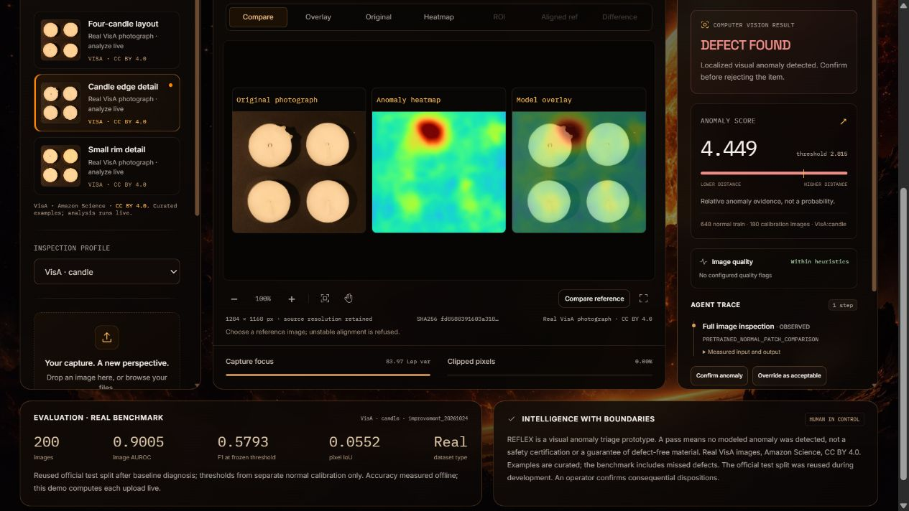

<p align="center"></p>

# REFLEX

**Visual inspection with evidence you can review.**

REFLEX helps quality inspectors and engineering reviewers examine product photographs. OpenCV 5 compares visual patterns with normal references, highlights unusual regions, and keeps the original image, heatmap, decision and human review together.

**[Watch the team demo](https://youtu.be/WvnKxOTxkvw)** · **[Try the AWS demo](https://re-c0a0c131729f4898bb80d160feb0ccc7.ecs.ap-southeast-2.on.aws/)** · **[One-minute reviewer tour](docs/REVIEWER_GUIDE.md)** · **[Run locally](docs/GETTING_STARTED.md)** · **[Documentation](docs/README.md)**

> **Current status:** working research prototype and submitted [OpenCV competition entry](https://devpost.com/software/reflex-xqn8i7). The public AWS demo runs the **v1 candle/cashew detector**. Adaptive **v2 remains local and held from release**; Safety Station is a separate local prototype evaluated on generated clips. Neither is a factory safety system. [Status and limits →](docs/PROJECT_STATUS.md)



*Working AWS v1 screen, captured 26 October 2026. Photograph: VisA / Amazon Science, CC BY 4.0; heatmap and overlay are derived outputs. This is a curated demonstration, not an accuracy estimate. [Screenshot provenance](docs/media/README.md).*

## Why REFLEX

A single score can hide a small defect or an unusable capture. The useful result is an inspection a person can check: what the system saw, where it found unusual evidence, which threshold it used, and what should happen next.

1. **Capture:** select a product profile and a real example, or upload an authorized image.
2. **Inspect:** compare normal-reference features and check image quality.
3. **Review:** compare source, heatmap and overlay; inspect the score and tool trace.
4. **Keep the evidence:** append an operator review and export JSON or printable HTML.

The local v2 candidate can inspect **one calibrated crop of the same photograph** when its first score is inconclusive. A weak second look stays under review. It does not move a camera or obtain a new optical view. The live v1 real-image profiles do not run this v2 crop policy.

## Start with a real photograph

Open the [AWS demo](https://re-c0a0c131729f4898bb80d160feb0ccc7.ecs.ap-southeast-2.on.aws/), keep **VisA · candle** selected, and try:

| Example | Recorded v1 score | Threshold | Recorded result |
| --- | ---: | ---: | --- |
| Four-candle layout | 1.547 | 2.815 | PASS |
| Candle edge detail | 4.449 | 2.815 | DEFECT FOUND |

Each click runs inference on the image bytes. Scores are anomaly distances, **not defect probabilities**. The library also includes subtle defective examples the detector misses. [Full walkthrough, UI controls and failure example →](docs/REVIEWER_GUIDE.md)

Use only licensed, non-private images on the public service. It has no user login or tenant isolation. Records expire after 24 hours and can disappear earlier when its task is replaced.

## What the measurements say

The image study covers **860 unique VisA photographs**, five product categories and 88 method/group rows. Reused replay, development and final partitions are kept separate; reviews never count as detections.

| Evaluation scope | Measured result | Source |
| --- | --- | --- |
| Reused replay: 350 images, including 200 defects | v1 detected **112/200**; primary v2 **155/200**, with 4 defect reviews | [Release assessment](benchmarks/anomaly_v2/RELEASE_ASSESSMENT.md) |
| New-category final: 255 images, including 150 defects | v2 detected **105/150**, falsely cleared 42 and left 3 defects under review; macro image AUROC fell **0.8520 → 0.8410** | [All methods and limits](benchmarks/anomaly_v2/README.md) |
| Dedicated Fargate CPU handler: 300 requests/version, 1 vCPU / 2 GiB | p95 **1.070 s → 1.256 s** from v1 to v2; excludes external network time | [Runtime evidence](benchmarks/anomaly_v2/RUNTIME.csv) |
| Procedure software tests: 18 generated clips × 3 policies | All policies **15/18** final statuses; **no observed agent accuracy gain**. Real procedure evaluation: **NOT_RUN** | [Procedure findings](benchmarks/procedural_safety/public/FINDINGS.md) |

Capsules remains a major failure: **34/50 final defects were falsely cleared**. The differently configured upstream PatchCore reference ranks higher in all eight measured groups. Historical custom AU-PRO values are invalid; read the [metric correction](benchmarks/anomaly_v2/METRIC_CORRECTION.md). These limits are why v2 stays local.

## Run locally

Use Python **3.12 or newer** with the [pinned dependencies](backend/requirements.txt); OpenCV major version 5 is required. Local recorded checks used Python 3.14, and the measured cloud image used 3.12. This is not a claim that every Python/platform combination has been tested.

```powershell
python -m venv .venv
.venv\Scripts\python -m pip install -r backend/requirements.txt
.venv\Scripts\python backend/scripts/prepare_public_weights.py
.venv\Scripts\python backend/scripts/dev.py --real
```

The weights helper explicitly downloads about 103 MB and verifies its pinned SHA-256. The launcher prints the actual loopback URLs. On Linux/macOS use `.venv/bin/python` instead. To start with generated samples and no weight download, omit the helper and `--real`.

**[Setup and troubleshooting](docs/GETTING_STARTED.md)** · **[Architecture and source map](docs/ARCHITECTURE_GUIDE.md)** · **[Verification commands](docs/GETTING_STARTED.md#verify-the-software)**

## Explore the project

| Looking for | Start here |
| --- | --- |
| What works, what is local, and what remains untested | [Current project status](docs/PROJECT_STATUS.md) |
| Detailed implementation and claim provenance | [85-question technical report](docs/REFLEX_YMCA_PPT_INTELLIGENCE_PUBLIC.md) |
| Protocol, comparisons, robustness and cloud measurements | [Anomaly study](benchmarks/anomaly_v2/README.md) · [numeric ledger](benchmarks/intelligence_20261025/README.md) |
| Generated procedure results and every retained case | [Procedure findings](benchmarks/procedural_safety/public/FINDINGS.md) · [gallery instructions](docs/REVIEWER_GUIDE.md#review-the-generated-procedure-evidence) |
| Paper, correction, slides and editable charts | [Deliverables index](docs/README.md#reports-and-presentations) |

## License and responsible use

[MIT](LICENSE) covers REFLEX source code. Data, model weights, fonts and artwork retain their own terms in [Third-party notices](THIRD_PARTY_NOTICES.md). Raw datasets, credentials, private uploads, databases and installed dependencies are excluded from the public source.

`PASS` means no modeled anomaly was detected in that image. It is not a guarantee of a defect-free product, safety certification or an automatic reject command. Human review remains separate from the machine finding.
