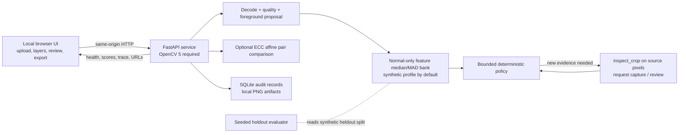
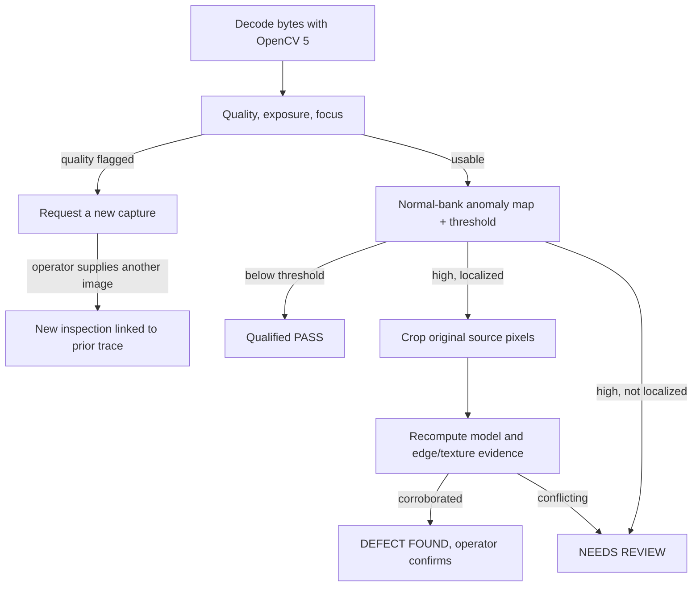
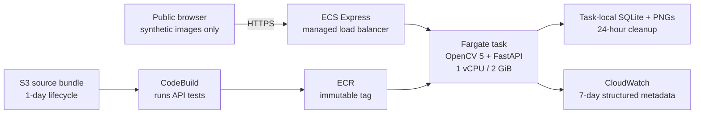

# Architecture

## Current local implementation

The default profile is synthetic and runs on the local service. The generic offline fit script can write a separate MVTec or VisA class model directory; set `MODEL_DIR` to that directory to activate the fitted class in a local service. The evaluated VisA profiles remain offline and are not deployed. Dataset images are not bundled or redistributed.

## Perception and action

The choice of `inspect_crop` depends on the first measured score and localized region. It is a distinct OpenCV operation with an actual crop input and computed result. The held-out synthetic experiment found no change in final decisions versus single-pass thresholding, so the agent's task-success benefit is not established yet.

## AWS deployment

The live judge path is browser → HTTPS ECS Express ingress → one ECS/Fargate OpenCV 5 task. The task writes inspection artifacts and audit rows to its ephemeral filesystem, with scheduled one-day cleanup; it does not write user images to S3. Structured metadata goes to CloudWatch. CodeBuild pulls a one-day private source bundle from S3, builds/tests the container, and publishes an immutable ECR image.

The service is public and has no user sign-in. Its page warns that images go to Sydney and that only synthetic samples should be used. Its per-process rate limit is not a shared quota. The endpoint, smoke evidence, and teardown steps are recorded in [`AWS_DEPLOYMENT.md`](AWS_DEPLOYMENT.md).

## Implementation links

- [FastAPI routes and startup guard](../backend/app/main.py)
- [Image decode and EXIF handling](../backend/app/core/image_io.py)
- [Quality and foreground proposal](../backend/app/core/quality.py)
- [Normal-only model, thresholds, regions, and rendering](../backend/app/core/model.py)
- [Agent policy and crop tool](../backend/app/agent/controller.py)
- [SQLite persistence and retention](../backend/app/storage.py)
- [ECC registration and difference](../backend/app/core/alignment.py)
- [Synthetic fixture generator](../backend/scripts/make_fixtures.py)
- [Evaluation method](../backend/scripts/evaluate.py)
- [Current evaluation](EVALUATION.md)
