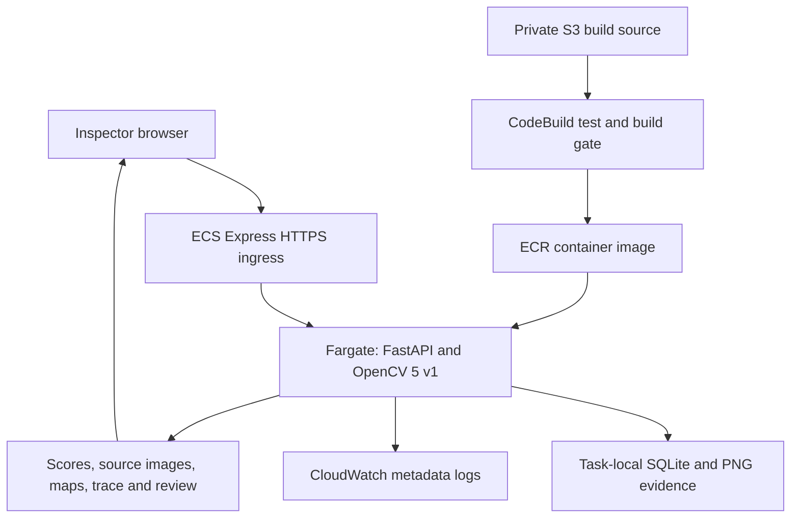
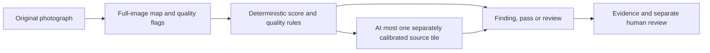

# Architecture and source map

[README](../README.md) · [Setup](GETTING_STARTED.md) · [Current status](PROJECT_STATUS.md) · [Detailed technical report](REFLEX_YMCA_PPT_INTELLIGENCE_PUBLIC.md)

## AWS v1

This is the implemented public still-image path in **ap-southeast-2**. S3 participates in delivery of build source; runtime image evidence stays on task storage.

The backend verifies fitted model/weight identities, decodes and normalizes input, obtains feature-distance maps, applies quality/profile rules, stores evidence and returns the inspection record. It uses normal-only memories over pretrained ResNet-50 features, not a defect-class fine-tune. Real profiles deliberately avoid arbitrary uncalibrated crop inference.

Task-local SQLite/PNGs, a per-process upload guard and an absence of user/tenant isolation limit public-demo persistence and scaling. This diagram is an architecture explanation, not a new load test. [Retained AWS evidence](aws_evidence.md).

## Local adaptive candidate

This path is implemented in the **local v2 candidate** and held from the public release. A selected tile reuses the same photograph. A request for another capture waits for an operator; there is no camera actuation. Unresolved evidence remains reviewable. The [policy controls](../benchmarks/anomaly_v2/AGENT_POLICIES.csv) bound what the experiments establish.

## Local Safety Station

The additive `extension_main` wrapper mounts the original app and adds `/safety` plus `/api/safety`. Its independent path is video/supplied frames → manual panel warp → quality/color/contour observations → temporal confirmation → recipe prerequisite checks → bounded extra observations → advisory result and review.

It uses capability-protected sessions and evidence records. Generated fixtures are explicitly labeled; one still cannot establish the entire procedure. See [the extension architecture](system_architecture.md) and [its safety/storage limits](limitations_and_safety.md). This extension is not deployed to the public AWS demo.

## Find the implementation

| Responsibility | Source |
| --- | --- |
| Original still-image API and exports | [backend/app/main.py](../backend/app/main.py) |
| Input decode and limits | [image_io.py](../backend/app/core/image_io.py) |
| Verified profile loading and inference | [engine.py](../backend/app/core/engine.py) · [v1 patch memory](../backend/app/core/patch_memory.py) |
| Local v2 memory and policy | [patch_memory_v2.py](../backend/app/core/patch_memory_v2.py) · [patch_policy_v2.py](../backend/app/agent/patch_policy_v2.py) |
| Optional two-image alignment | [alignment.py](../backend/app/core/alignment.py) |
| Additive app entrypoint | [extension_main.py](../backend/app/extension_main.py) |
| Procedure observations and temporal engine | [vision.py](../backend/reflex_safety/vision.py) · [engine.py](../backend/reflex_safety/engine.py) |
| Procedure API and session store | [api.py](../backend/reflex_safety/api.py) · [store.py](../backend/reflex_safety/store.py) |
| Interface | [Inspection Studio](../frontend/index.html) · [Safety Station](../frontend/safety.html) |
| Frozen-evaluation implementation | [reflex_bench](../backend/reflex_bench) · [procedure benchmark](../backend/reflex_safety/benchmark.py) |

Registration, generated-video validation, real-image detection and physical safety are different claims. The [technical report](REFLEX_YMCA_PPT_INTELLIGENCE_PUBLIC.md) traces their implementation and measurement boundaries separately.
