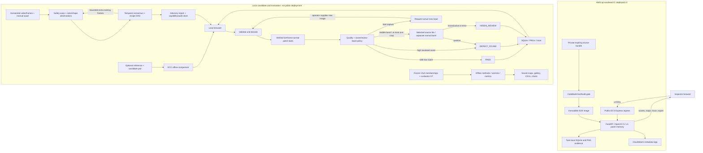

# REFLEX AWS — YMCA presentation technical intelligence

Audit date: 25 October 2026. Canonical project: the REFLEX source checkout.

**Purpose:** factual foundation for a presentation, not a new release. Application source and UI were not changed. Existing benchmark outputs were preserved. Fresh local checks and read-only public endpoint/pricing requests are distinguished from historical experiments throughout.

**Decision:** keep the v2 release hold. REFLEX has an executable, evidence-dependent second-look policy and real industrial photograph results. Evidence does **not** establish calibrated model uncertainty, general superiority over random crops, compute savings, registration-induced accuracy improvement, factory readiness, or validated physical procedure safety.

> **Public edition.** This is a portable projection of the 25 October local intelligence audit. Benchmark values and limitations are unchanged. Links point to published source where available; private-only evidence is explicitly marked. Selected VisA-derived illustrations retain CC BY 4.0 attribution. Raw datasets and local logs are excluded.

## Reading and evidence conventions

The two supplied texts were read completely. The 916-line second document is reproduced exactly within the 1,048-line first document; the first adds presentation framing and proposed experiments. Proposed numbers and slide narratives were treated as proposals. This report addresses Q1–Q85 using Parts A–J. The earlier 6-slide and current 10-slide decks remain existing artifacts; no new deck was requested by this evidence-gathering task.

`R` below means the absolute canonical project above; `E` means `R\reports\improvement_v2_20261024`; `A` means `R\reports\intelligence_20261025T111700Z`. These are path abbreviations, not additional checkouts. Clickable links expand them.

**Evidence hierarchy:** saved per-case outcomes/maps and frozen memberships → independently checked machine-readable tables → reports → charts → proposed presentation language. A test passing establishes its tested behavior, not model accuracy. A deployed health check establishes reachability/readiness, not current accuracy or load capacity. “Normal” is a dataset label, not a product-safety certificate.

Core evidence: [frozen scientific protocol](<../benchmarks/anomaly_v2/PROTOCOL.md>), [all 88 result rows](<../benchmarks/anomaly_v2/ALL_RESULTS.csv>), independent image-metric oracle (private local evidence; excluded from public source), [fresh audit](<../benchmarks/intelligence_20261025/VERIFICATION.json>), [complete numeric benchmark ledger](<../benchmarks/intelligence_20261025/BENCHMARK_LEDGER.csv>).

## PART A — EXECUTIVE SUMMARY

### Q1. What is REFLEX AWS?

**One sentence:** REFLEX is an OpenCV visual inspection prototype that compares images with normal references, records anomaly evidence, and can selectively inspect a source-image crop or request human review.

**50-word technical explanation:**

REFLEX combines OpenCV image validation, normal reference patch memories, calibrated thresholds, anomaly maps, and bounded inspection policies. Its local candidate selectively rescans native image crops and abstains when evidence remains inconclusive. A separate procedural prototype checks teaching panel sequences. The public AWS deployment currently serves the earlier still image detector.

**150-word explanation for judges:**

REFLEX helps an inspector examine a product photograph and understand why the software flags it. It compares visual patterns with examples of normal products, marks unusual regions, and preserves the original image alongside a heatmap and inspection record. Our local candidate can take one closer look at a selected region when the first score falls into a review band. If that extra evidence is inconclusive, the result remains under review. This behavior is implemented and demonstrated on real public industrial photographs. However, it is not a guarantee that every defect will be found. Our experiments show improvements on reused candle and cashew images, substantial remaining capsule misses, and higher cloud resource use for the candidate. The public AWS demo currently runs the earlier detector. A separate teaching panel prototype checks assembly history using generated videos. We have not validated factory safety, operator time savings, or automatic second camera acquisition yet.

### Q2. Precise problem

An inspection image can contain a small defect, harmless appearance variation, or insufficient evidence. A single threshold can miss subtle defects or produce false alerts. REFLEX investigates normal-only detection, spatial localization, bounded additional evidence, and explicit review rather than treating every low score as certain. This problem is supported by the observed misses; the claim that human inspectors are slower, less consistent, or more expensive has **not** been measured here.

### Q3. Users and validated applications

Intended users are quality inspectors, assembly trainers, and engineering reviewers. Real evaluation covers published **VisA candle, cashew, PCB1, capsules and chewinggum photographs**. The teaching-panel procedural prototype uses generated videos. No factory pilot, infrastructure inspection, construction-site use, clinical use, commercial customer outcome, live production line or physical assembly safety benefit has been validated. These are possible applications, not established markets or deployments.

### Q4. Inputs and outputs

Still inspection accepts PNG, JPEG and WebP through MIME plus byte/header validation, up to 12 MiB, 4096 pixels per edge and 20 megapixels. It supports grayscale, alpha compositing, 8/16-bit normalization and EXIF orientation. The active category/profile must match. A single photograph needs no corresponding clean photograph at inference: its fitted normal memory supplies the reference. The separate optional alignment tool takes two same-sized images.

Outputs include original pixels after decoding/normalization, anomaly score and thresholds, non-probabilistic score margin, quality flags, heatmap, overlay, binary anomaly mask, bounded regions, tool trace, model/input hashes, decision and human-review history. JSON and printable HTML exports exist. HTML can be printed to PDF; a native PDF-generation endpoint is absent.

Safety Station separately accepts a still frame, uploaded video replay or supplied camera frames with consent, a selected recipe and manual board quadrilateral. Video uploads allow recognized AVI/MP4/WebM containers with matching permitted MIME, at most 50 MiB, 120 seconds, five megapixels and a 2560-pixel edge; OpenCV must actually open the codec and report valid frame/fps metadata. Its supported visual vocabulary is one colored teaching panel. Actual video decoding is implemented. Physical browser-camera operation remains unverified. Its outputs are procedural observations, evidence frames, reasons and advisory PASS/HOLD/REJECT recommendations, not machine control.

### Q5. End-to-end workflow

1. Open Inspection Studio, select the fitted category and upload a permitted image or select a licensed example.
2. Backend validates, decodes and normalizes the input, loads and verifies the profile/weight hashes, and computes a score map.
3. Quality checks and the active profile's bounded policy determine PASS, DEFECT_FOUND or NEEDS_REVIEW. Local v2 may execute one separately calibrated crop; public v1 patch profiles do not.
4. Backend stores SQLite metadata and original/heatmap/overlay/mask PNGs and returns evidence URLs and trace. The frontend lets the user compare original and model layers.
5. The user can append a review without altering the machine prediction, export JSON/HTML, or supply a new image when a retake is requested. A continuation is a new linked inspection; it is not an autonomous camera movement.

Safety workflow: consent/source → manual calibration → actual frames → warp/color/shape observations → temporal consensus → recipe DAG checks → optional bounded extra frames → final checkpoint → report/operator acknowledgement. Incomplete history remains reviewable.

### Q6. Three implemented differentiators and three results

Capabilities: (1) scale-specific normal memories plus a bounded crop policy; (2) explicit abstention and provenance-rich evidence; (3) a separate temporal recipe verifier that distinguishes visible final state from observed history. These are engineering integrations, not established new algorithms.

Three strongest headline findings: reused replay detections increased **112/200 → 155/200**, with four defects still under review; actual local v2 crop activation was **46/860 cases**; measured dedicated Fargate v2 handler p95 was **1256.22 ms**, versus v1 **1070.47 ms**, exposing a regression rather than a speed claim. Parts C and H give scope and negatives.

**Current deployment:** [AWS demo](https://re-c0a0c131729f4898bb80d160feb0ccc7.ecs.ap-southeast-2.on.aws/) returned HTTP 200 for home, health and readiness on 25 October 2026 at about 11:13 UTC. Build is `reflex-20261024t095525z`, OpenCV 5.0.0. This is v1. Local v2 and Safety Station are not deployed; `/safety` returned 404. Fresh HTTP receipt (private local evidence; excluded from public source).

## PART B — SYSTEM ARCHITECTURE

### Q7. Actual stack

| Layer | Actual implementation / version | Boundary |
|---|---|---|
| Frontend | HTML, CSS, vanilla JavaScript; separate safety page/scripts | No React or frontend bundler |
| Backend | Python; FastAPI 0.116.1, Uvicorn 0.35.0, Pydantic 2.12.5 | Python 3.14.6 local; 3.12.15 measured Fargate image |
| Vision | opencv-python-headless 5.0.0.93; runtime 5.0.0; NumPy 2.3.3; Pillow 13.0.0 | Startup enforces OpenCV major version 5 |
| Models | Classical median/MAD normal bank; ImageNet ResNet50 ONNX stage-2/3 patch memory v1/v2 | No industrial defect classifier fine-tuning; no LLM decision maker |
| Reference evaluation | Pinned upstream PatchCore, WRN50-2, Torch 2.14.1+cpu, torchvision 0.29.1+cpu, FAISS 1.15.1 | Separate local benchmark environment |
| Still persistence | SQLite plus filesystem PNGs | Ephemeral task filesystem on AWS |
| Safety persistence | Filesystem snapshots, hash-linked audit records, capability-token hashes | Local; no organizational RBAC |
| Orchestration | Deterministic Python policies; temporal consensus and recipe DAG | No Bedrock agent loop |
| Cloud | ECS Express, Fargate, managed load balancer, ECR, CodeBuild, S3 build bundle, CloudWatch, CloudFormation, service roles | Selected Region ap-southeast-2 |
| Visualization | OpenCV TURBO heatmaps/overlays, native browser controls; offline scientific figures and editable PowerPoint charts | Heat color is not defect probability |

Version evidence: [backend dependencies](<../backend/requirements.txt>), fresh local environment (private local evidence; excluded from public source), profile records (private local evidence; excluded from public source).

### Q8–Q9. Actual flow and modules

**Corrected flow:** decode/validation → verified normal-memory inference → score map + quality/suitability → profile-specific policy → optional detail pass/review → assets/storage/API. Registration is a **separate optional pair-comparison route**, not a stage automatically executed before anomaly detection. Safety uses its own manual planar calibration rather than the ECC utility.

| Module | Input → output; responsibility | Main dependencies |
|---|---|---|
| `app/core/image_io.py` | Encoded bytes → normalized BGR and source metadata | OpenCV, Pillow/header parsing |
| `app/core/engine.py` | Profile/weights → hash-verified cached model, then inference result | Model modules, bounded cache, four CV threads |
| `app/core/model.py` | Normal-only spatial features → classical map/score; contour regions and rendering | Lab, filters, robust statistics |
| `app/core/patch_memory.py` | Image → ResNet features → projected nearest-normal distances | Verified ONNX graph/weights, stored normal patches |
| `app/core/patch_memory_v2.py` | Full map → valid-patch scoring; optional selected native-source tile | Separate full/detail bank metadata |
| `app/core/quality.py`, `suitability_v2.py` | Pixels → heuristic capture flags and normal-tail warning clues | No test labels; suitability warnings do not route |
| `app/agent/controller.py`, `patch_policy_v2.py` | Scores/flags/regions → bounded tools, disposition, trace | Active profile identity |
| `app/core/alignment.py` | Same-sized pair → accepted affine image/difference or explicit rejection | ECC, warpAffine, Lab difference |
| `app/main.py`, `storage.py` | HTTP uploads/reviews → persisted inspection/evidence/export | SQLite/files, retention, input/rate checks |
| `app/extension_main.py` | Existing app + additive safety routes/page | Preserves existing Studio entry |
| `reflex_safety/vision.py` | Calibrated frame → part/slot/quality observations | warpPerspective, HSV thresholds, contours |
| `reflex_safety/engine.py`, `recipe.py` | Temporal observations → confirmed state, DAG checks, advisory decision | Unique-frame consensus, evidence history |
| `reflex_safety/api.py`, `store.py` | Capability-bound sessions, uploads, cancellation, reports and acknowledgement | Separate per-session data and audit chain |
| `reflex_bench/*`, `reflex_safety/benchmark.py` | Frozen data/predictions → metrics and reproducible evidence | Labels/masks evaluator-only |

| Source reference | Verified definition lines |
| --- | --- |
| [backend/app/main.py](<../backend/app/main.py>) | def _bootstrap_local_assets: 37; async def lifespan: 49; async def _cleanup_periodically: 68; async def upload_rate_limit: 87; def _build_revision: 135; def _demo_hashes: 144; def _validate_upload_mime: 151; def _write_asset: 161; def _profile_directory: 168; def _real_demo_cases: 175; def _inspect_bytes: 180; async def health: 275; async def ready: 293; async def profiles: 304; async def demo_cases: 316; async def inspections: 327; async def create_inspection: 332; async def get_inspection: 339; async def continue_inspection: 347; async def review: 361; async def export: 375; async def align_pair: 390; async def latest_evaluation: 411; async def unexpected_error: 435 |
| [backend/app/core/alignment.py](<../backend/app/core/alignment.py>) | def align_affine: 7; def compare_aligned: 35 |
| [backend/app/core/image_io.py](<../backend/app/core/image_io.py>) | def image_mime: 20; def _encoded_dimensions: 30; def sha256_bytes: 76; def decode_image: 80; def encode_png: 134 |
| [backend/app/core/engine.py](<../backend/app/core/engine.py>) | def _patch_profile: 16; def load_bank: 23; def analyze: 43 |
| [backend/app/core/model.py](<../backend/app/core/model.py>) | def read_bgr: 19; def feature_map: 26; def _score_features: 39; def _image_score: 45; def fit_normal_bank: 49; def load_bank: 95; def analyze: 110; def extract_regions: 137; def render_evidence: 168 |
| [backend/app/core/patch_memory.py](<../backend/app/core/patch_memory.py>) | def digest: 27; def preprocess: 32; def unletterbox: 48; def nearest_distances: 55; def coreset: 64; def embed: 100; def predict: 119; def analyze: 132; def load: 197; def _read: 211 |
| [backend/app/core/patch_memory_v2.py](<../backend/app/core/patch_memory_v2.py>) | def valid_patch_centers: 47; def balanced_indices: 54; def patch_scores: 74; def restore_map: 89; def grid_map: 96; def tile_boxes: 102; def choose_tile: 109; def random_tile: 113; def _read: 118; def _thresholds: 125; def embed: 136; def predict: 206; def _fit_memory: 221; def calibrate_review: 301; def analyze: 324; def save: 365; def load: 374; def fit_detail: 399 |
| [backend/app/core/suitability_v2.py](<../backend/app/core/suitability_v2.py>) | def _digest: 22; def _small: 26; def _features: 35; def _robust_parameters: 98; def _scores: 104; def _read: 118; def fit_suitability: 125; def inspect_suitability: 173 |
| [backend/app/agent/controller.py](<../backend/app/agent/controller.py>) | def _now: 14; def _evidence_id: 18; def inspect_crop: 22; def run_policy: 51; def run_patch_policy: 118 |
| [backend/app/agent/patch_policy_v2.py](<../backend/app/agent/patch_policy_v2.py>) | def run_v2_policy: 8 |
| [backend/app/storage.py](<../backend/app/storage.py>) | def connect: 13; def initialize: 27; def cleanup_expired: 35; def register_artifact: 53; def save_inspection: 62; def get_inspection: 67; def append_review: 79; def list_inspections: 89 |
| [backend/reflex_safety/vision.py](<../backend/reflex_safety/vision.py>) | def analyze_frame: 10 |
| [backend/reflex_safety/engine.py](<../backend/reflex_safety/engine.py>) | def analyze_video: 108 |
| [backend/reflex_safety/store.py](<../backend/reflex_safety/store.py>) | def utc: 7; def directory: 8; def save: 11; def get: 15; def create: 20; def authorize: 28; def public: 32; def append: 33; def audit: 43; def recover: 45; def delete: 51 |
| [backend/reflex_safety/api.py](<../backend/reflex_safety/api.py>) | def access: 41; def idle: 45; def mutable: 47; async def read_file: 50; def recipes: 59; def fixtures: 63; def fixture_media: 70; def create: 77; def get: 86; async def upload: 89; def evidence_callback: 107; def run: 119; def start: 135; def cancel: 146; def events: 155; def media: 159; def evidence: 165; async def frame: 173; def finish: 195; def reinspect: 201; def acknowledge: 212; def report: 218; def delete: 225; def benchmark_runs: 230; def benchmark_run: 235 |

### Q10. Failure behavior

| Failure | Implemented behavior | Remaining limitation |
|---|---|---|
| Bad/empty/oversized image | Structured 400/413; unsupported category 422 | Limits are not a hostile-media security proof |
| ECC non-convergence, mismatch, unstable transform | `accepted=false`, reason, no aligned comparison | No overlap confidence model or automatic downstream fallback |
| Missing/mutated model/weights | Integrity/load exception; readiness cannot succeed | No silent alternate model; unexpected inference errors can return server error |
| Detail inference exception | Explicit `DETAIL_INFERENCE_FAILED`; uncertain path remains review | Tool failure is not a defect finding |
| Poor quality | Retake/review action, bounded termination | May over-abstain; does not recover missing visual evidence |
| No reliable probability | Returns score/margin with `calibrated_probability=false` | No calibrated probability exists to fall back to |
| Cloud unavailable | Frontend/API error; use verified offline artifacts/local app | No automatic cloud-to-local failover |
| Missing safety history/occlusion/cancel/truncation | HOLD/reason or cancelled state; no invented completed sequence | Permanent history gap can cause false holds after visibility recovers |

### Q11–Q12. Distinctive choices and architecture specification

Scale-specific normal calibration, source-coordinate tile evidence, conservative unresolved-review behavior, and explicit temporal-history constraints are deliberate project choices. ECC, pretrained features, nearest-neighbor memory, FastAPI and AWS containers are established components. This audit does not establish a new scientific invention or patent novelty.



No runtime S3 image upload, Bedrock, SageMaker, Rekognition, Lambda, Cognito, DynamoDB or RDS connection belongs in this diagram. Build services do not perform the anomaly inference.

### Q13–Q17. Registration: algorithm, quality and gaps

The actual algorithm is **ECC affine intensity alignment**: grayscale conversion; identity 2×3 initial warp; `cv2.findTransformECC` with `MOTION_AFFINE`, 100 iterations, epsilon 1e-6 and Gaussian filter size 5. There are no feature keypoints, correspondence matches, RANSAC inliers or homography solver in this utility. Accepted candidates are warped with linear interpolation, inverse-map flag and reflected border.

Acceptance requires correlation ≥0.72, determinant in [0.65,1.45], and translation norm ≤25% of the longer image dimension. The output exposes correlation, transform, determinant and translation magnitude. **Translation is not residual registration error.** Comparison reports mean/p95 per-pixel Lab RMS difference, not reprojection error.

Fresh regression includes translated synthetic-image acceptance and size-mismatch rejection. There is **no real-pair registration success-rate benchmark, landmark residual error, inlier ratio, overlap estimation, or downstream registration-on/off accuracy table**. Do not put an invented registration gain in a slide.

Affine geometry can represent rotation/scale/shear, but that is not measured robustness over those changes. Perspective is not fully modeled. Poor overlap, major pose change, repetitive/flat texture, blur, occlusion or photometric changes are plausible failure conditions; only explicit rejection paths and the narrow translation test are verified here. The anomaly stress study's +7° rotation is not a registration study. ECC's official interface is documented by [OpenCV](https://docs.opencv.org/4.13.0/dc/d6b/group__video__track.html); the project behavior is established by its OpenCV 5 code/tests, not assumed from 4.x documentation.

### Q18–Q23. Detection, masks, metric meaning and nuisance changes

**Classical baseline:** resize to 120×90, derive five features (Lab lightness, local residual, absolute Laplacian, Sobel magnitude and chroma), fit per-position medians and MAD scales from normals, then score robust normalized deviations. Scale floors and score clipping limit numerical extremes. This is a useful simple baseline but performs poorly on the tested real categories.

**v1/v2:** fixed ImageNet-pretrained ResNet50 stage-2/3 features are patch-pooled, combined into 1536 dimensions, projected to 128 or 512 dimensions and compared with a normal-only coreset using exact nearest L2 distance. V1 samples 24 patches/image; v2 uses 96 spatially balanced valid patches and up to 4096 coreset entries. Projection and greedy selection are seeded. V2 changes coverage, valid-padding handling, scoring, smoothing and review behavior together; v1→v2 is not one isolated causal ablation.

Training strategy is normal-only industrial fitting/calibration on **supervised ImageNet-pretrained features**. It is not training a defect-class classifier, nor proof of self-supervised end-to-end learning. Defect labels and masks are used only for scoring after predictions; development and exposed replay still constrain generalization claims.

**Masks:** nearest-patch distances are restored to source coordinates. V2 primary uses sigma-1 smoothing and a normal-calibration 99.75th-percentile pixel threshold. The API binary patch mask is directly `score_map > pixel_threshold`. Classical output thresholds the low-resolution map then resizes with nearest-neighbor interpolation. Region display separately applies a 3-pixel elliptical opening/closing and contour/area filtering, returning at most eight regions. Do not say the exported binary mask universally has the same morphology as the region visualization. These are anomaly localization masks, not semantic defect-type segmentation.

Image precision/recall/F1/AUROC/AP/FPR and false-clear counts exist. Pixel precision/recall/IoU/Dice/AUROC/AP and corrected region-weighted AU-PRO exist. Region any-overlap recall/component IoU and defect-area strata exist. **AP is grouped average precision, not interchangeable with trapezoidal AUPRC.** Binary-mask IoU/Dice are threshold-specific. AUROC is ranking, not thresholded decision accuracy. Resolved-only recall can conceal reviews; this report uses all defect denominators and shows reviews separately.

Harmless-change defenses are normal feature coverage, ImageNet normalization, letterboxing, calibration and quality checks. V2 suitability computes warning-only normal-distribution clues. There is no proven semantic nuisance/defect separation, universal illumination invariance or learned recognition of defect types. Product category is a selected profile, not a recognized anomaly class. Procedural class/placement/missing/order reason codes belong to the separate teaching-panel module.

### Q24–Q29. Actual second-look policy and uncertainty

Full-image input is aspect-preserving letterboxed to 256×256. Four overlapping corner tiles span 62.5% of native width and height; each selected crop is independently resized to the same 256 input, giving greater source-detail density. The chosen tile maximizes the **mean first-pass anomaly map over the tile**, without ground truth. Its normal memory and threshold are separate from the full-frame bank. A crop is the same photograph, not a second optical camera view.

Let `s` be the full-frame score; `T=Q0.95(normal calibration scores)`; `L` is a lower pass boundary selected among calibration quantiles {0.80,0.85,0.90,0.95}. Reserved normal-development canonical/+7° images select the lowest boundary with ≤10% extra review in both normal variants. Primary image score is the maximum local 3×3 mean of valid patch distances; max/top-four alternatives are separate fixed arms.

```text
quality flag                         -> request retake / NEEDS_REVIEW
s > T and localized evidence         -> DEFECT_FOUND
s <= L                               -> PASS
L < s <= T and detail model available -> one chosen native-source crop
    detail score > separate chosen-T -> DEFECT_FOUND
    else / inference error           -> NEEDS_REVIEW
middle-band with no detail evidence  -> human review
```

The displayed score margin is `(s - T) / max(std(normal_calibration_scores), 1e-6)`. It is a standardized distance, **not** a probability, entropy, Bayesian uncertainty or ensemble disagreement. Suitability tail ranks are `p=(1+count(calibration_score>=new_score))/(n+1)`, checked against alpha/3; exchangeability with future suitable captures is unverified. Suitability explicitly returns `routing_flags=[]`, `WARNING_ONLY`, no visibility or semantic identity certificate.

Still-image quality flags use short edge <128, Laplacian focus variance <12, clipping fraction >0.28, mean brightness outside [8,247], dynamic range <18, or aspect ratio >5. The quality score is `min(1,focus/80) × (1-clipping)`, clipped to [0,1], and explicitly uncalibrated. A naming inconsistency remains: `dynamic_range_p98_minus_p02` is actually computed as the 99th minus 1st percentile. This audit records that discrepancy without changing the frozen implementation.

The local v2 policy controls tile selection, one additional model pass, termination and escalation. It does not choose an arbitrary new resolution, move a camera, train a model online or call a generative agent. Its decisions are adaptive because flags/scores/maps change its actions; the rules are deterministic. Synthetic legacy profiles have a native ROI tool; **live v1 real patch profiles deliberately avoid uncalibrated arbitrary crop inference**.

Stopping: one automatic calibrated detail call in v2; otherwise final disposition. An operator-supplied retake is a separate linked run. That continuation API has no demonstrated cumulative session-wide retake budget; do not claim a global bound on repeated human continuations. Safety replay has a two-extra-frame budget, at most 600 decoded frames, 120-second source metadata limit, 90-second outer processing loop and cancellation. Frame-upload sessions stop after 200 frames or timestamps beyond 120 seconds; two video jobs may run concurrently. Default temporal confirmation needs three distinct frame hashes, observations separated by at least 150 ms and no gap over 750 ms. Replay base sampling is approximately 300 ms. A native codec call can still outlast the outer processing limit; the loop bound is not process isolation.

### Q30–Q33. What the loop actually proves

See Part C for matched controls and Part E for authentic full traces. Second-look execution and a changed decision are verified; broad accuracy/efficiency improvement is only partial. Across 860 mixed-population cases, 46 triggered one detail action (**5.3488%**, logical mean **1.05349** full-plus-detail calls). Five of eight groups had no defect-triggered crop; capsules had no crop triggers at all. The triggered group sizes are too small for broad ROI-selection claims.

The review-only control and chosen/random policies falsely clear the exact same defective case IDs in every group. **The lower review boundary accounts for the reduction in automatic false clears; a positive crop resolves some reviews into findings.** It is not legitimate to attribute all false-clear reduction to ROI reasoning. Chosen versus random reuses a four-tile evaluator batch and has no independent matched timing. The aggregate chosen-only/random-only defect discordance is 7/2; a descriptive exact two-sided binomial comparison gives p=0.1796875. This post-hoc mixed-population calculation is not preregistered superiority evidence. [Derived arithmetic](<../benchmarks/intelligence_20261025/DERIVED.json>).

### Q63–Q70. AWS integration, privacy, deployment, cost and scale

**Actual AWS path and reasons:** ECS Express ingress provides HTTPS service access; Fargate runs the Python/OpenCV container; ECR supplies the immutable image; CodeBuild tests/builds it from a private expiring S3 bundle; CloudFormation declares resources; CloudWatch records structured metadata. Service/execution/infrastructure roles allow these services to cooperate. No special AI cloud service performs the vision inference.

The last verified real-photo release is `reflex-20261024t095525z`, image digest `a7a6de72935e94a43460a2a0125a07b7214624de2940eb1bd097f4a7f106ef34`. Historical release receipts record stable stacks and six actual VisA inspections with matching evidence/score identities. Fresh HTTP checks confirm the build/health/readiness, **not a new CLI inventory of all resources or policy drift**. The dedicated v2 benchmark task was stopped after measurement; it was not the live UI release.

Relevant nonsecret configuration includes `REFLEX_RUNTIME`, `BUILD_COMMIT`, `MODEL_DIR`, `REFLEX_PROFILES_DIR`, `REFLEX_ONNX_WEIGHTS`, `REFLEX_DATA_DIR`, default-profile selection, `INSPECTION_RETENTION_DAYS`, `UPLOADS_PER_WINDOW`, `UPLOAD_RATE_WINDOW_SECONDS` and optional `REFLEX_REVIEW_TOKEN`. Never publish token values or local AWS credential caches. Exact deployed configuration is historical receipt evidence; changing local values does not change AWS.

Security/privacy: HTTPS transport, restrictive same-origin CSP, nosniff, no-referrer and frame denial were observed again. Image signature/dimension/MIME limits are implemented. The public v1 service has **no user login or tenant isolation**; its listing/asset routes are not private customer storage. The optional reviewer token protects review only when configured; current secret configuration was not inspected. The per-process guard defaults to ten uploads per client per ten minutes and is not a distributed quota. Use licensed/non-private examples.

Historical deployed retention is one day with periodic cleanup; task replacement can remove data sooner. Metadata logs retain seven days; source bundles expire after one day. SQLite and PNGs stay on task storage, not runtime S3. No application-level encryption-at-rest key management was verified. Safety local capability headers, token hashes, separate sessions and audit chain improve access/evidence control, but they do not establish organizational authorization or secure multi-tenant deployment. Video decoding remains in-process; an individual codec call can outlast the outer loop limit. Public hostile-media hardening is incomplete.

**Cost estimate (Q69), not actual bill:** At current retrieved Linux x86 Sydney rates, one 1-vCPU/2-GiB task costs `1 × $0.04856 + 2 × $0.00532 = $0.0592 per task-hour`. For 730 provisioned hours, compute alone is **US$43.216 (about $43.22)**; for 24 hours, **US$1.4208**. No actual project bill was queried.

This uses the official [Sydney ECS price-list JSON](https://pricing.us-east-1.amazonaws.com/offers/v1.0/aws/AmazonECS/current/ap-southeast-2/index.json), retrieved during this audit. Formula/rate inputs and Decimal arithmetic are saved in PRICING.json (private local evidence; excluded from public source) and [DERIVED.json](<../benchmarks/intelligence_20261025/DERIVED.json>). This is a requested-resource compute estimate for a continuously running task, not a measured cost per inspection or complete AWS cost. It excludes managed load balancer, public IPv4, logs, ECR/S3, build, network, tax, credits and discounts. [AWS pricing](https://aws.amazon.com/fargate/pricing/) explains requested-resource billing. Current free/paid plan, remaining credits and invoice were **not refreshed**. Do not quote the old $100 screenshot as the current balance.

Scaling: the recorded service target is one task; no autoscaling/saturation/failover experiment was completed. Model inference locks, CPU, full-resolution asset serialization, task-local SQLite/PNGs, independent in-process quotas, limited caches and synchronous request work are bottlenecks. Adding replicas would require shared persistence/access/rate controls to preserve behavior. That is architectural possibility, not tested scalability. Public pacing and finite concurrency-two probes do not establish production capacity.

## PART C — DATASET AND BENCHMARK EVIDENCE

### Q34–Q36. Actual datasets and denominators

VisA is real public industrial imagery with image/pixel labels. The official registry describes 12 categories and 10,821 images (9,621 normal, 1,200 anomalous), under CC BY 4.0. This study uses five categories; it does not evaluate all VisA or prove private-factory performance. [Official VisA registry](https://registry.opendata.aws/visa/).

| Category | Normal fit | Normal calibration | Reserved train-normal development | Published-test diagnostic development | Published-test final | Reused replay |
|---|---:|---:|---:|---|---|---|
| candle | 648 | 180 | 72 | — | — | 200: 100 normal / 100 defect |
| cashew | 324 | 90 | 36 | — | — | 150: 50 normal / 100 defect |
| pcb1 | 651 | 181 | 72 | 100: 50 normal / 50 defect | 100: 50 normal / 50 defect | — |
| capsules | 391 | 108 | 43 | 80: 30 normal / 50 defect | 80: 30 normal / 50 defect | — |
| chewinggum | 326 | 91 | 36 | 75: 25 normal / 50 defect | 75: 25 normal / 50 defect | — |

Exact image dimensions in evaluated memberships: candle: 1284×1168 (200 images); cashew: 1274×1176 (150 images); pcb1: 1404×1070 (200 images); capsules: 1500×1000 (160 images); chewinggum: 1342×1118 (150 images). The model's common input is 256×256 letterboxed. The evaluator's common full-frame grid has maximum side 256. Original-coordinate threshold masks have a separate native-resolution table; display galleries enlarge saved maps and must not be presented as native dense inference.

**Population accounting:** 350 exposed replay + 255 diagnostic development + 255 final = **860 unique source images**. Eleven methods/arms per group produce **88 rows / 9,460 repeated image predictions**. These are not 9,460 independent images. Dependent stress tests produce **5,445 transformed cases** from 605 replay/final originals. The detail study's 24 forced-fusion rows and the 40 policy-control rows reuse the same inputs; they add evidence, not independent subjects. Quantitative real paired-image evaluation: **none**.

The complete acquired VisA archive is 1,929,840,640 bytes, locally hashed `2eb8690c803ab37de0324772964100169ec8ba1fa3f7e94291c9ca673f40f362`. A local hash is not a publisher signature. Official split hash is `a48557e6033318cb90556f706196bc9d247a776a23ea51aecee5a80dd0332995`. Publisher byte checks for selected acquisition portions and manifest provenance are retained; no new dataset was downloaded for this audit.

**Other data:** seeded machined-plate synthetic tests have 40 fit, 12 calibration and 32 holdout images (12 normal/20 defect). The provided 96-image synthetic QA kit is separate from VisA; no explicit redistribution license was established for it. Safety uses 26 generated 640×480 MJPG videos, 10 fps, six seconds/60 frames each: 4 train, 4 validation, 18 test, 1,560 frames total; its 54 predictions are three policies over the same 18 test clips. No legitimate physical procedure benchmark was completed; an Assembly101 access attempt was gated. Do not represent generated video or transformed photographs as independent real-world captures. A MVTec-capable reader is not evidence of an executed MVTec study.

### Q37–Q40. Protocol, reproducibility, leakage and generalization

Fit/calibration/development memberships are content-hash separated; defect labels/masks enter only after predictions return. All v2 model/source/configuration hashes were frozen before final scoring. Primary `dense128_region` and seed 20261024 were declared before outcomes; fixed seed repeats 20261025 and 20261026 are all reported. There was no best-seed replacement. Review-boundary selection used reserved normal-development scores, not defect labels.

Image scores are compared with image labels for AUROC/AP and fixed-threshold confusion. Pixel maps and masks are compared on common full-frame geometry including normal images with zero masks; masks use nearest-neighbor geometry. Region any-overlap recall and area slices are additional diagnostics, not substitutes for IoU. Categorical macro averages weight categories equally and are not pooled image AUROC.

Exact duplicate and heuristic similarity audits found no split edges in the inspected manifests, but physical-part/lot identifiers are absent. Candle/cashew are development replay forever after repeated inspection. New categories are new-to-REFLEX, not a fully unseen dataset: they each have their own normal fit/calibration and come from the same published VisA distribution. This is category extension with sealed final partitions, **not** zero-shot transfer, physical-site generalization or independent factory validation. Curated demo images are not a random additional benchmark.

Reproducibility includes pinned ONNX SHA `3f03fdef724b22947eed826f1eef1dc5c34151bb4c37d634f1db89dfa2dd1526`, feature-graph SHA `13f53653570d3ad98231c463d4ee4ec202306ba3614166f52f10d31e472cb5e6`, saved banks/configs, manifests, per-case CSVs, raw/smoothed maps, source freezes, commands, logs and independent readers. **143/143 frozen files match in this audit.** Public source excludes private datasets/weights; clean checkout alone is not a complete local reproduction bundle.

Benchmark commands recorded in the ledger are historical invocation forms, not commands executed in this audit. `reflex_bench.improve_v2` hardcodes the historical output directory; **do not rerun it in place**, including `freeze`, `train`, `evaluate`, `detail` or `robustness`. Safe future execution needs a separate copy/output adapter and new run registration. This audit re-read frozen metrics and ran existing tests only. Reproduction is technically specified; blindly rerunning a writer would damage provenance.

### Q41–Q43. Measured comparisons

Each table row's metric is tied to its exact population. Precision = TP/(TP+FP); recall uses **all original defects**, including unresolved reviews in its denominator. F1 here uses `2TP/(2TP+FP+automatic_FN+defect_reviews)`. Reviews are never counted as detections. IoU is pixel IoU at the frozen normal threshold, not image IoU. Per-arm latency is N/A here because the cached experimental pass is not production timing; the separate matched service profile follows below.

| Method | Dataset group | N | Alert precision | Recall/all defects | F1 incl. defect reviews as undetected | Pixel IoU | Image AUROC | Reviews | Matched per-arm latency |
| --- | --- | --- | --- | --- | --- | --- | --- | --- | --- |
| v1 | candle/replay | 200 | 0.9333 | 0.4200 | 0.5793 | 0.0552 | 0.9005 | 0 | N/A |
| classical_cv5 | candle/replay | 200 | 0.8000 | 0.1600 | 0.2667 | 0.0096 | 0.7575 | 0 | N/A |
| dense128_region | candle/replay | 200 | 0.9286 | 0.7800 | 0.8478 | 0.0769 | 0.9566 | 4 | N/A |
| v1 | cashew/replay | 150 | 0.9722 | 0.7000 | 0.8140 | 0.2336 | 0.9476 | 0 | N/A |
| classical_cv5 | cashew/replay | 150 | 0.6250 | 0.0500 | 0.0926 | 0.1897 | 0.5964 | 0 | N/A |
| dense128_region | cashew/replay | 150 | 1.0000 | 0.7700 | 0.8701 | 0.2697 | 0.9600 | 0 | N/A |
| v1 | pcb1/development | 100 | 0.9091 | 0.6000 | 0.7229 | 0.1471 | 0.8932 | 0 | N/A |
| classical_cv5 | pcb1/development | 100 | 0.8571 | 0.2400 | 0.3750 | 0.0142 | 0.7916 | 0 | N/A |
| dense128_region | pcb1/development | 100 | 0.8636 | 0.7600 | 0.8085 | 0.2037 | 0.9112 | 7 | N/A |
| v1 | pcb1/final | 100 | 0.8286 | 0.5800 | 0.6824 | 0.1392 | 0.8488 | 0 | N/A |
| classical_cv5 | pcb1/final | 100 | 0.7143 | 0.2000 | 0.3125 | 0.0208 | 0.7848 | 0 | N/A |
| dense128_region | pcb1/final | 100 | 0.8200 | 0.8200 | 0.8200 | 0.1871 | 0.8780 | 10 | N/A |
| v1 | capsules/development | 80 | 0.9412 | 0.3200 | 0.4776 | 0.1698 | 0.7027 | 0 | N/A |
| classical_cv5 | capsules/development | 80 | 0.7143 | 0.1000 | 0.1754 | 0.0289 | 0.6087 | 0 | N/A |
| dense128_region | capsules/development | 80 | 0.8750 | 0.2800 | 0.4242 | 0.2038 | 0.6680 | 0 | N/A |
| v1 | capsules/final | 80 | 1.0000 | 0.3200 | 0.4848 | 0.2443 | 0.7233 | 0 | N/A |
| classical_cv5 | capsules/final | 80 | 0.6923 | 0.1800 | 0.2857 | 0.0132 | 0.5653 | 0 | N/A |
| dense128_region | capsules/final | 80 | 0.9412 | 0.3200 | 0.4776 | 0.3362 | 0.6713 | 0 | N/A |
| v1 | chewinggum/development | 75 | 1.0000 | 0.9600 | 0.9796 | 0.0870 | 0.9680 | 0 | N/A |
| classical_cv5 | chewinggum/development | 75 | 0.5000 | 0.0200 | 0.0385 | 0.0078 | 0.5520 | 0 | N/A |
| dense128_region | chewinggum/development | 75 | 0.9800 | 0.9800 | 0.9800 | 0.1338 | 0.9912 | 3 | N/A |
| v1 | chewinggum/final | 75 | 0.9400 | 0.9400 | 0.9400 | 0.0717 | 0.9840 | 0 | N/A |
| classical_cv5 | chewinggum/final | 75 | 1.0000 | 0.0600 | 0.1132 | 0.0232 | 0.5736 | 0 | N/A |
| dense128_region | chewinggum/final | 75 | 0.9231 | 0.9600 | 0.9412 | 0.1048 | 0.9736 | 1 | N/A |

All rows above were measured locally on the fixed memberships, CPU/OpenCV 5, with no GPU. Historical command: `python -m reflex_bench.improve_v2 evaluate --category CATEGORY --split POPULATION`; source tables and oracle are linked below. V1 and classical fits use matching normal memberships. Candidate and upstream reference have different model/preprocessing configurations; do not infer a single-component cause.

**Aggregate final-policy outcomes (populations kept separate):**

| Population / method | N / defects / normals | TP / FP / auto-FN / TN | Defect / normal reviews | Recall all | Normal FPR | Macro image AUROC |
| --- | --- | --- | --- | --- | --- | --- |
| replay / classical_cv5 | 350 / 200 / 150 | 21 / 7 / 179 / 143 | 0 / 0 | 0.1050 | 0.0467 | 0.676950 |
| replay / v1 | 350 / 200 / 150 | 112 / 5 / 88 / 145 | 0 / 0 | 0.5600 | 0.0333 | 0.924050 |
| replay / dense128_region | 350 / 200 / 150 | 155 / 6 / 41 / 144 | 4 / 0 | 0.7750 | 0.0400 | 0.958300 |
| development / classical_cv5 | 255 / 150 / 105 | 18 / 5 / 132 / 100 | 0 / 0 | 0.1200 | 0.0476 | 0.650756 |
| development / v1 | 255 / 150 / 105 | 94 / 4 / 56 / 101 | 0 / 0 | 0.6267 | 0.0381 | 0.854622 |
| development / dense128_region | 255 / 150 / 105 | 101 / 9 / 44 / 91 | 5 / 5 | 0.6733 | 0.0857 | 0.856800 |
| final / classical_cv5 | 255 / 150 / 105 | 22 / 8 / 128 / 97 | 0 / 0 | 0.1467 | 0.0762 | 0.641244 |
| final / v1 | 255 / 150 / 105 | 92 / 9 / 58 / 96 | 0 / 0 | 0.6133 | 0.0857 | 0.852044 |
| final / dense128_region | 255 / 150 / 105 | 105 / 14 / 42 / 83 | 3 / 8 | 0.7000 | 0.1333 | 0.840978 |

**Fixed-arm ranking/localization matrix, all 88 rows:**

| Group | Arm | N | Image AUROC | Image AP | Pixel AP | Pixel IoU | Corrected AU-PRO≤.30 |
| --- | --- | --- | --- | --- | --- | --- | --- |
| candle/replay | v1 | 200 | 0.9005 | 0.8967 | 0.1635 | 0.0552 | 0.9424 |
| candle/replay | classical_cv5 | 200 | 0.7575 | 0.7313 | 0.0097 | 0.0096 | 0.7291 |
| candle/replay | dense128_region | 200 | 0.9566 | 0.9546 | 0.1752 | 0.0769 | 0.9311 |
| candle/replay | dense128_max | 200 | 0.9489 | 0.9535 | 0.1752 | 0.0769 | 0.9311 |
| candle/replay | dense128_top4 | 200 | 0.9519 | 0.9537 | 0.1752 | 0.0769 | 0.9311 |
| candle/replay | dense512_max | 200 | 0.9373 | 0.9374 | 0.1712 | 0.0745 | 0.9371 |
| candle/replay | dense128_pose | 200 | 0.9441 | 0.9486 | 0.1841 | 0.0747 | 0.9329 |
| candle/replay | dense128_seed20261025 | 200 | 0.9476 | 0.9509 | 0.1865 | 0.0680 | 0.9385 |
| candle/replay | dense128_seed20261026 | 200 | 0.9298 | 0.9317 | 0.1589 | 0.0762 | 0.9402 |
| candle/replay | dense512_seed20261025 | 200 | 0.9273 | 0.9332 | 0.1774 | 0.0752 | 0.9390 |
| candle/replay | dense512_seed20261026 | 200 | 0.9375 | 0.9409 | 0.1849 | 0.0752 | 0.9402 |
| cashew/replay | v1 | 150 | 0.9476 | 0.9744 | 0.5209 | 0.2336 | 0.9150 |
| cashew/replay | classical_cv5 | 150 | 0.5964 | 0.7124 | 0.1663 | 0.1897 | 0.6498 |
| cashew/replay | dense128_region | 150 | 0.9600 | 0.9818 | 0.5487 | 0.2697 | 0.9130 |
| cashew/replay | dense128_max | 150 | 0.9512 | 0.9778 | 0.5487 | 0.2697 | 0.9130 |
| cashew/replay | dense128_top4 | 150 | 0.9582 | 0.9810 | 0.5487 | 0.2697 | 0.9130 |
| cashew/replay | dense512_max | 150 | 0.9636 | 0.9824 | 0.5556 | 0.2593 | 0.9111 |
| cashew/replay | dense128_pose | 150 | 0.9650 | 0.9841 | 0.5570 | 0.2684 | 0.9161 |
| cashew/replay | dense128_seed20261025 | 150 | 0.9606 | 0.9817 | 0.5439 | 0.2568 | 0.9170 |
| cashew/replay | dense128_seed20261026 | 150 | 0.9564 | 0.9798 | 0.5478 | 0.2798 | 0.9123 |
| cashew/replay | dense512_seed20261025 | 150 | 0.9488 | 0.9772 | 0.5514 | 0.2648 | 0.9184 |
| cashew/replay | dense512_seed20261026 | 150 | 0.9478 | 0.9767 | 0.5344 | 0.2622 | 0.9148 |
| pcb1/development | v1 | 100 | 0.8932 | 0.8901 | 0.8466 | 0.1471 | 0.7975 |
| pcb1/development | classical_cv5 | 100 | 0.7916 | 0.7713 | 0.0166 | 0.0142 | 0.5333 |
| pcb1/development | dense128_region | 100 | 0.9112 | 0.9101 | 0.8386 | 0.2037 | 0.7913 |
| pcb1/development | dense128_max | 100 | 0.9176 | 0.9171 | 0.8386 | 0.2037 | 0.7913 |
| pcb1/development | dense128_top4 | 100 | 0.9248 | 0.9226 | 0.8386 | 0.2037 | 0.7913 |
| pcb1/development | dense512_max | 100 | 0.8912 | 0.8976 | 0.8469 | 0.2056 | 0.8243 |
| pcb1/development | dense128_pose | 100 | 0.9172 | 0.9119 | 0.8396 | 0.2028 | 0.7669 |
| pcb1/development | dense128_seed20261025 | 100 | 0.8740 | 0.8793 | 0.8419 | 0.1882 | 0.8285 |
| pcb1/development | dense128_seed20261026 | 100 | 0.8856 | 0.8948 | 0.8415 | 0.2058 | 0.8256 |
| pcb1/development | dense512_seed20261025 | 100 | 0.9080 | 0.9169 | 0.8455 | 0.1970 | 0.8267 |
| pcb1/development | dense512_seed20261026 | 100 | 0.9200 | 0.9216 | 0.8448 | 0.1973 | 0.8408 |
| pcb1/final | v1 | 100 | 0.8488 | 0.8539 | 0.8325 | 0.1392 | 0.8323 |
| pcb1/final | classical_cv5 | 100 | 0.7848 | 0.7412 | 0.0169 | 0.0208 | 0.5574 |
| pcb1/final | dense128_region | 100 | 0.8780 | 0.8733 | 0.8227 | 0.1871 | 0.8362 |
| pcb1/final | dense128_max | 100 | 0.8688 | 0.8629 | 0.8227 | 0.1871 | 0.8362 |
| pcb1/final | dense128_top4 | 100 | 0.8856 | 0.8794 | 0.8227 | 0.1871 | 0.8362 |
| pcb1/final | dense512_max | 100 | 0.8596 | 0.8544 | 0.8237 | 0.1896 | 0.8348 |
| pcb1/final | dense128_pose | 100 | 0.8916 | 0.8841 | 0.8271 | 0.1865 | 0.8555 |
| pcb1/final | dense128_seed20261025 | 100 | 0.8792 | 0.8872 | 0.8153 | 0.1711 | 0.8330 |
| pcb1/final | dense128_seed20261026 | 100 | 0.8512 | 0.8607 | 0.8155 | 0.1877 | 0.8229 |
| pcb1/final | dense512_seed20261025 | 100 | 0.8556 | 0.8721 | 0.8211 | 0.1763 | 0.8425 |
| pcb1/final | dense512_seed20261026 | 100 | 0.8608 | 0.8708 | 0.8310 | 0.1791 | 0.8530 |
| capsules/development | v1 | 80 | 0.7027 | 0.8137 | 0.1878 | 0.1698 | 0.5720 |
| capsules/development | classical_cv5 | 80 | 0.6087 | 0.7197 | 0.0183 | 0.0289 | 0.4029 |
| capsules/development | dense128_region | 80 | 0.6680 | 0.7947 | 0.3199 | 0.2038 | 0.5815 |
| capsules/development | dense128_max | 80 | 0.6800 | 0.8029 | 0.3199 | 0.2038 | 0.5815 |
| capsules/development | dense128_top4 | 80 | 0.6720 | 0.7942 | 0.3199 | 0.2038 | 0.5815 |
| capsules/development | dense512_max | 80 | 0.6593 | 0.7943 | 0.3824 | 0.2670 | 0.6303 |
| capsules/development | dense128_pose | 80 | 0.6593 | 0.7837 | 0.3028 | 0.2187 | 0.5891 |
| capsules/development | dense128_seed20261025 | 80 | 0.6880 | 0.8087 | 0.2799 | 0.2025 | 0.6046 |
| capsules/development | dense128_seed20261026 | 80 | 0.6727 | 0.8081 | 0.3172 | 0.2481 | 0.6036 |
| capsules/development | dense512_seed20261025 | 80 | 0.6747 | 0.8060 | 0.3404 | 0.2487 | 0.5398 |
| capsules/development | dense512_seed20261026 | 80 | 0.7013 | 0.8182 | 0.3474 | 0.2536 | 0.6216 |
| capsules/final | v1 | 80 | 0.7233 | 0.8421 | 0.3993 | 0.2443 | 0.4418 |
| capsules/final | classical_cv5 | 80 | 0.5653 | 0.6971 | 0.0121 | 0.0132 | 0.3906 |
| capsules/final | dense128_region | 80 | 0.6713 | 0.8278 | 0.4991 | 0.3362 | 0.5058 |
| capsules/final | dense128_max | 80 | 0.6813 | 0.8345 | 0.4991 | 0.3362 | 0.5058 |
| capsules/final | dense128_top4 | 80 | 0.6747 | 0.8300 | 0.4991 | 0.3362 | 0.5058 |
| capsules/final | dense512_max | 80 | 0.7253 | 0.8414 | 0.5110 | 0.3455 | 0.5594 |
| capsules/final | dense128_pose | 80 | 0.7540 | 0.8648 | 0.5172 | 0.3501 | 0.5201 |
| capsules/final | dense128_seed20261025 | 80 | 0.6927 | 0.8459 | 0.4479 | 0.3145 | 0.4303 |
| capsules/final | dense128_seed20261026 | 80 | 0.7067 | 0.8351 | 0.4990 | 0.3396 | 0.4809 |
| capsules/final | dense512_seed20261025 | 80 | 0.7207 | 0.8513 | 0.5608 | 0.3790 | 0.4960 |
| capsules/final | dense512_seed20261026 | 80 | 0.6567 | 0.8191 | 0.5597 | 0.3882 | 0.4616 |
| chewinggum/development | v1 | 75 | 0.9680 | 0.9885 | 0.4752 | 0.0870 | 0.7962 |
| chewinggum/development | classical_cv5 | 75 | 0.5520 | 0.6786 | 0.0583 | 0.0078 | 0.5925 |
| chewinggum/development | dense128_region | 75 | 0.9912 | 0.9964 | 0.5173 | 0.1338 | 0.7794 |
| chewinggum/development | dense128_max | 75 | 0.9920 | 0.9965 | 0.5173 | 0.1338 | 0.7794 |
| chewinggum/development | dense128_top4 | 75 | 0.9920 | 0.9967 | 0.5173 | 0.1338 | 0.7794 |
| chewinggum/development | dense512_max | 75 | 0.9808 | 0.9928 | 0.4919 | 0.1227 | 0.7942 |
| chewinggum/development | dense128_pose | 75 | 0.9904 | 0.9958 | 0.5241 | 0.1332 | 0.7824 |
| chewinggum/development | dense128_seed20261025 | 75 | 0.9864 | 0.9940 | 0.6051 | 0.1184 | 0.8142 |
| chewinggum/development | dense128_seed20261026 | 75 | 0.9984 | 0.9992 | 0.5158 | 0.1266 | 0.7818 |
| chewinggum/development | dense512_seed20261025 | 75 | 0.9880 | 0.9948 | 0.4706 | 0.1202 | 0.7902 |
| chewinggum/development | dense512_seed20261026 | 75 | 0.9936 | 0.9971 | 0.5058 | 0.1276 | 0.7777 |
| chewinggum/final | v1 | 75 | 0.9840 | 0.9929 | 0.4844 | 0.0717 | 0.8686 |
| chewinggum/final | classical_cv5 | 75 | 0.5736 | 0.7069 | 0.0779 | 0.0232 | 0.5618 |
| chewinggum/final | dense128_region | 75 | 0.9736 | 0.9894 | 0.5548 | 0.1048 | 0.8430 |
| chewinggum/final | dense128_max | 75 | 0.9744 | 0.9905 | 0.5548 | 0.1048 | 0.8430 |
| chewinggum/final | dense128_top4 | 75 | 0.9712 | 0.9890 | 0.5548 | 0.1048 | 0.8430 |
| chewinggum/final | dense512_max | 75 | 0.9768 | 0.9909 | 0.5583 | 0.0953 | 0.8541 |
| chewinggum/final | dense128_pose | 75 | 0.9944 | 0.9972 | 0.5556 | 0.1031 | 0.8395 |
| chewinggum/final | dense128_seed20261025 | 75 | 0.9848 | 0.9938 | 0.6171 | 0.0911 | 0.8660 |
| chewinggum/final | dense128_seed20261026 | 75 | 0.9840 | 0.9931 | 0.5155 | 0.0966 | 0.8556 |
| chewinggum/final | dense512_seed20261025 | 75 | 0.9840 | 0.9933 | 0.5274 | 0.0924 | 0.8536 |
| chewinggum/final | dense512_seed20261026 | 75 | 0.9880 | 0.9954 | 0.5514 | 0.0972 | 0.8504 |

Source: [ALL_RESULTS.csv](<../benchmarks/anomaly_v2/ALL_RESULTS.csv>), [MACRO_RESULTS.csv](<../benchmarks/anomaly_v2/MACRO_RESULTS.csv>). Verification: frozen source/model hashes checked now; image metrics agree with the saved independent 88-row oracle; no inference rerun is implied. Ledger status `VERIFIED_SAVED_RESULT` means verified saved evidence, not fresh experimental repetition.

**Upstream PatchCore reference, actual execution:**

| Group | N | V1 AUROC | Primary AUROC | Reference AUROC | Primary TP / FP / reviews | Reference TP / FP / FN / TN | Variant |
| --- | --- | --- | --- | --- | --- | --- | --- |
| cashew/replay | 150 | 0.9476 | 0.9600 | 0.9746 | 77 / 0 / 0 | 83 / 2 / 17 / 48 | standard |
| candle/replay | 200 | 0.9005 | 0.9566 | 0.9906 | 78 / 6 / 4 | 91 / 5 / 9 / 95 | streamed |
| capsules/development | 80 | 0.7027 | 0.6680 | 0.7160 | 14 / 2 / 0 | 18 / 4 / 32 / 26 | standard_restart |
| capsules/final | 80 | 0.7233 | 0.6713 | 0.8000 | 16 / 1 / 0 | 26 / 1 / 24 / 29 | standard_restart |
| chewinggum/development | 75 | 0.9680 | 0.9912 | 0.9928 | 49 / 1 / 3 | 47 / 0 / 3 / 25 | standard_restart |
| chewinggum/final | 75 | 0.9840 | 0.9736 | 0.9840 | 48 / 4 / 1 | 47 / 1 / 3 / 24 | standard_restart |
| pcb1/development | 100 | 0.8932 | 0.9112 | 0.9988 | 38 / 6 / 7 | 49 / 1 / 1 / 49 | streamed |
| pcb1/final | 100 | 0.8488 | 0.8780 | 0.9644 | 41 / 9 / 10 | 48 / 5 / 2 / 45 | streamed |

Pinned upstream `amazon-science/patchcore-inspection` commit `fcaa92f124fb1ad74a7acf56726decd4b27cbcad` uses WRN50-2, 1024-dimensional embedding, patch size 3, 10% approximate-greedy coreset, exact FAISS squared-L2, resize-256/center-crop-224 and CPU four threads. Cashew/capsules/chewinggum use standard orchestration; candle/PCB1 use a disclosed disk-backed assembly wrapper after allocation failures. Small-fixture parity supports that wrapper, not full-run byte equality. Reference AUROC exceeds the primary in all eight groups, but backbone, memory size, preprocessing and scorer change together. This is neither official leaderboard reproduction nor a fair AWS speed comparison. [Comparison/method scope](<../benchmarks/anomaly_v2/REFERENCE_COMPARISON.md>); [PatchCore primary paper](https://openaccess.thecvf.com/content/CVPR2022/html/Roth_Towards_Total_Recall_in_Industrial_Anomaly_Detection_CVPR_2022_paper.html).

Reference pixel denominators differ: capsule center crops retain only **59.93%** of development defect pixels and **84.67%** of final defect pixels, fully excluding five/three defective images respectively. Its crop pixel AP/AU-PRO must not be compared directly with REFLEX full-frame metrics.

### Q44–Q46. Ablations, agent contribution and honest deltas

| Ablation family | Actually available | Conclusion permitted |
|---|---|---|
| Registration on/off | No real-data downstream experiment | No accuracy/IoU gain claim |
| Dense coverage/dimensions/scoring/pose/seeds | Nine predeclared arms + v1 + classical, eight groups | Configuration comparison with disclosed coupled changes |
| Multi-scale forced fusion | Full + chosen / random / all four, 24 rows | Higher/equal logical-budget controls; not automatically the selective path |
| Review-only versus crop policy | 40 rows, five policies × eight groups | Separates abstention effect from review resolution |
| Quality gate off | Same canonical results here | No benefit on canonical suitable images; not proof gates unnecessary under stress |
| Pixel smoothing/threshold | 48 rows: sigma 1/4 × normal q .995/.9975/.999 × eight groups | Same-map postprocessing sensitivity; no test-IoU winner selection |
| Always-versus-selective runtime | No independent randomized fixed-budget policy timing | No ROI efficiency-superiority claim |
| Safety single/random/agent | 54 predictions, 18 generated test clips | Actual equality of outcomes, no physical safety benefit |

**Agent matched-control accounting:**

| Policy | N | TP / FP / auto-FN / TN | Reviews | Extra logical model calls |
| --- | --- | --- | --- | --- |
| chosen_quality_gate_off | 860 | 361 / 29 / 127 / 318 | 25 | 46 |
| chosen_roi_off | 860 | 344 / 25 / 127 / 318 | 46 | 0 |
| chosen_selective | 860 | 361 / 29 / 127 / 318 | 25 | 46 |
| random_selective | 860 | 356 / 27 / 127 / 318 | 32 | 46 |
| static_quality_gate | 860 | 344 / 25 / 156 / 335 | 0 | 0 |

| Group | N | Actual crop triggers | Triggered defects / normals | Trigger rate |
| --- | --- | --- | --- | --- |
| candle/replay | 200 | 16 | 13 / 3 | 8.00% |
| cashew/replay | 150 | 0 | 0 / 0 | 0.00% |
| pcb1/development | 100 | 12 | 10 / 2 | 12.00% |
| pcb1/final | 100 | 14 | 6 / 8 | 14.00% |
| chewinggum/development | 75 | 3 | 0 / 3 | 4.00% |
| chewinggum/final | 75 | 1 | 0 / 1 | 1.33% |
| capsules/development | 80 | 0 | 0 / 0 | 0.00% |
| capsules/final | 80 | 0 | 0 / 0 | 0.00% |

The whole-860 policy table is execution accounting over mixed populations, not pooled independent validation. Chosen detail resolves **17 additional true alerts and four false alerts** relative to review-only; random resolves 12 and two. Automatic false clears stay 127 for chosen, random and ROI-off. The static threshold has 156 false clears; the 29-case reduction comes from withholding uncertain PASS decisions. This distinction is essential to the project's central claim.

**Directly comparable percentage calculations** (computed in the audit script):

- Reused replay detected fraction: `(155/200 - 112/200) × 100 = +21.5 percentage points`; relative detected-count change `(155/112 - 1) × 100 = +38.3929%`.
- Replay automatic false clears: `(1 - 41/88) × 100 = 53.4091% fewer`; four defects are unresolved reviews, so this does not mean 47 new detections. True detections rose by 43.
- New-category final macro AUROC: `100 × (0.8409777778 - 0.8520444444) = -1.1067 percentage points`; detections 92→105/150, false alerts 9→14/105, reviews 0→11. Threshold recall improves while ranking and false-alert burden worsen.
- Dedicated AWS handler p95: `(1256.2202/1070.4691 - 1) × 100 = +17.3523%`; peak RSS `(463192064/321888256 - 1) × 100 = +43.8984%`. These are regressions.

See [DETAIL_FUSION.csv](<../benchmarks/anomaly_v2/DETAIL_FUSION.csv>), [AGENT_POLICIES.csv](<../benchmarks/anomaly_v2/AGENT_POLICIES.csv>), [LOCALIZATION_ABLATIONS.csv](<../benchmarks/anomaly_v2/LOCALIZATION_ABLATIONS.csv>), active-case contribution audit (private local evidence; excluded from public source).

### Q47–Q48. Reliability of conclusions and missing benchmarks

There are eight evaluation groups, nine fixed v2 configurations including repeated seeds, plus two baselines. Seed repeats are not independent datasets and do not establish uncertainty calibration. Report every arm, not the largest number. No controlled multi-run hardware confidence interval was collected; raw latency distributions/std/p50/p95 exist. The saved reference uses different configuration/field of view. Reviews, correlated augmentations, exposed replay, small triggered subsets and shared hardware are material confounders. Wilson intervals in safety results describe tiny generated clip samples, not factory rates.

Part J prioritizes the missing real-capture adaptive-policy, registration ablation and controlled compute comparisons, with exact runnable existing commands and explicit missing-harness boundaries. No numerical improvement is predicted.

### Q56–Q62. Hardware, timing, memory and compute

| Environment | Actual scope |
|---|---|
| Local v2 study/profile | Windows 11; Python 3.14.6; OpenCV 5.0.0; 32 logical CPUs reported; AMD64 Family 25 Model 97 Stepping 2; host visible RAM 24,752,529,408 bytes; four OpenCV threads. Shared host work, not a reserved 32-core benchmark allocation. |
| Dedicated Fargate comparison | Linux, Python 3.12.15, OpenCV 5.0.0, Intel Xeon Platinum 8259CL 2.50 GHz; requested 1 vCPU / 2 GiB, no GPU. Host-visible two CPUs/4 GB are not task allocation. |
| Public v1 | Same recorded 1 vCPU / 2 GiB service allocation; actual internet/ingress and CloudWatch timing measured separately. |
| Upstream reference | CPU-only separate environment, four Torch/FAISS threads, larger normal memory; prediction-only timing excludes preprocessing and competes with other work. |

**Service profile, raw spans (milliseconds):**

| Environment / variant | Span | N | Mean | Std | p50 | p95 | Max |
| --- | --- | --- | --- | --- | --- | --- | --- |
| aws_fargate_loopback/v1 | loopback_http_ms | 300 | 985.223 | 105.821 | 973.744 | 1080.943 | 1733.216 |
| aws_fargate_loopback/v1 | server_handler_ms | 300 | 974.335 | 104.160 | 963.285 | 1070.469 | 1699.292 |
| aws_fargate_loopback/v1 | runtime_ms | 300 | 960.871 | 101.455 | 950.427 | 1052.211 | 1681.567 |
| aws_fargate_loopback/v2 | loopback_http_ms | 300 | 1139.933 | 176.383 | 1117.201 | 1267.479 | 2799.357 |
| aws_fargate_loopback/v2 | server_handler_ms | 300 | 1128.780 | 175.618 | 1104.674 | 1256.220 | 2787.022 |
| aws_fargate_loopback/v2 | runtime_ms | 300 | 1114.848 | 172.735 | 1091.555 | 1241.322 | 2763.623 |
| local_loopback_r4/v1 | loopback_http_ms | 300 | 436.662 | 662.433 | 324.583 | 597.464 | 6943.336 |
| local_loopback_r4/v1 | server_handler_ms | 300 | 417.490 | 662.815 | 303.358 | 574.214 | 6919.911 |
| local_loopback_r4/v1 | runtime_ms | 300 | 334.130 | 508.726 | 277.995 | 340.244 | 6722.217 |
| local_loopback_r4/v2 | loopback_http_ms | 300 | 516.813 | 957.382 | 366.338 | 755.602 | 10205.672 |
| local_loopback_r4/v2 | server_handler_ms | 300 | 497.839 | 957.301 | 346.205 | 738.266 | 10180.884 |
| local_loopback_r4/v2 | runtime_ms | 300 | 379.861 | 472.991 | 332.908 | 524.762 | 8480.281 |
| aws_public_segmented/v1 | http_roundtrip_ms | 100 | 3956.656 | 614.401 | 3904.446 | 4722.947 | 7185.793 |
| aws_public_segmented/v1 | server_runtime_ms | 100 | 953.164 | 49.306 | 956.751 | 1027.269 | 1091.400 |
| aws_public_segmented/v1 | cloudwatch_full_handler_ms | 100 | 2497.525 | 356.515 | 2469.207 | 3127.237 | 3683.244 |

**Stage timing, every saved row:**

| Environment / variant | Span | N | Mean ms | p50 ms | p95 ms | Max ms |
| --- | --- | --- | --- | --- | --- | --- |
| aws_fargate_loopback/v1 | agent_policy_ms | 300 | 20.891 | 13.590 | 49.951 | 54.780 |
| aws_fargate_loopback/v1 | artifacts_and_payload_ms | 300 | 235.926 | 228.059 | 264.437 | 859.477 |
| aws_fargate_loopback/v1 | decode_validate_ms | 300 | 9.253 | 8.898 | 11.419 | 78.323 |
| aws_fargate_loopback/v1 | detail_inspection_ms | 300 | 0.000 | 0.000 | 0.000 | 0.000 |
| aws_fargate_loopback/v1 | profile_load_ms | 300 | 1.624 | 1.577 | 1.922 | 7.553 |
| aws_fargate_loopback/v2 | agent_policy_ms | 300 | 21.736 | 13.838 | 54.078 | 119.451 |
| aws_fargate_loopback/v2 | artifacts_and_payload_ms | 300 | 250.185 | 238.522 | 279.729 | 1364.527 |
| aws_fargate_loopback/v2 | decode_validate_ms | 300 | 8.031 | 8.350 | 9.866 | 37.178 |
| aws_fargate_loopback/v2 | detail_inspection_ms | 300 | 12.382 | 0.000 | 0.000 | 685.332 |
| aws_fargate_loopback/v2 | feature_aggregation_projection_ms | 300 | 36.679 | 24.444 | 74.663 | 81.465 |
| aws_fargate_loopback/v2 | feature_extraction_ms | 300 | 350.114 | 356.859 | 410.510 | 563.334 |
| aws_fargate_loopback/v2 | feature_pipeline_ms | 300 | 413.060 | 421.607 | 469.999 | 670.397 |
| aws_fargate_loopback/v2 | opencv_preprocess_ms | 300 | 26.249 | 25.274 | 28.291 | 48.578 |
| aws_fargate_loopback/v2 | patch_distance_ms | 300 | 193.466 | 191.517 | 244.985 | 434.851 |
| aws_fargate_loopback/v2 | profile_load_ms | 300 | 45.877 | 48.690 | 52.827 | 122.519 |
| aws_fargate_loopback/v2 | quality_and_regions_ms | 300 | 124.272 | 121.288 | 167.483 | 319.881 |
| aws_fargate_loopback/v2 | score_map_reconstruction_ms | 300 | 3.715 | 1.664 | 6.151 | 59.546 |
| local_loopback_r4/v1 | agent_policy_ms | 300 | 3.147 | 3.003 | 3.960 | 6.846 |
| local_loopback_r4/v1 | artifacts_and_payload_ms | 300 | 185.286 | 129.866 | 187.739 | 6584.615 |
| local_loopback_r4/v1 | decode_validate_ms | 300 | 5.383 | 5.264 | 7.521 | 9.092 |
| local_loopback_r4/v1 | detail_inspection_ms | 300 | 0.000 | 0.000 | 0.000 | 0.000 |
| local_loopback_r4/v1 | profile_load_ms | 300 | 2.372 | 2.143 | 3.916 | 5.511 |
| local_loopback_r4/v2 | agent_policy_ms | 300 | 3.398 | 3.174 | 4.759 | 9.513 |
| local_loopback_r4/v2 | artifacts_and_payload_ms | 300 | 166.131 | 132.736 | 198.663 | 8102.533 |
| local_loopback_r4/v2 | decode_validate_ms | 300 | 5.748 | 5.305 | 9.181 | 14.233 |
| local_loopback_r4/v2 | detail_inspection_ms | 300 | 2.172 | 0.000 | 0.000 | 129.921 |
| local_loopback_r4/v2 | feature_aggregation_projection_ms | 300 | 25.621 | 23.938 | 36.904 | 64.312 |
| local_loopback_r4/v2 | feature_extraction_ms | 300 | 46.766 | 44.161 | 67.144 | 106.022 |
| local_loopback_r4/v2 | feature_pipeline_ms | 300 | 83.446 | 78.805 | 116.650 | 190.916 |
| local_loopback_r4/v2 | opencv_preprocess_ms | 300 | 11.042 | 10.186 | 15.636 | 25.661 |
| local_loopback_r4/v2 | patch_distance_ms | 300 | 18.505 | 17.632 | 25.375 | 37.489 |
| local_loopback_r4/v2 | profile_load_ms | 300 | 31.358 | 29.874 | 48.114 | 90.711 |
| local_loopback_r4/v2 | quality_and_regions_ms | 300 | 53.980 | 51.596 | 78.469 | 104.887 |
| local_loopback_r4/v2 | score_map_reconstruction_ms | 300 | 2.176 | 2.041 | 3.432 | 5.268 |

Nested/overlapping spans and their quantiles must not be added. Some finer v1 spans are absent, not zero. Registration was not timed in these studies. Detail p95 can be zero because most requests do not trigger it; detail inference is not free. The reported first trace `elapsed_ms=0` is a placeholder, not proof that the full pass takes zero time. Cached evaluator `elapsed_ms_with_feature_cache` must never be used as production latency.

**Finite concurrency probe:**

| Environment / variant | Concurrent | Requests | Seconds | Observed requests/s |
| --- | --- | --- | --- | --- |
| aws_fargate_loopback/v1 | 2 | 100 | 100.040 | 0.9996 |
| aws_fargate_loopback/v2 | 2 | 100 | 111.153 | 0.8997 |
| local_loopback_r4/v1 | 2 | 100 | 27.832 | 3.5930 |
| local_loopback_r4/v2 | 2 | 100 | 33.247 | 3.0078 |

Dedicated local and Fargate profiles each contain 820 requests: two variants × (10 warm-up + 300 sequential measured + 100 concurrency-two). The 100 fixtures are reused across rounds, so 300 timing requests are not 300 unique accuracy cases. Actual application module/bank/input identities are retained. Dedicated task stop exit 0 is recorded. Earlier local R1/R2/R3 attempts failed or had invalid layout/memory measurement and remain preserved; R4 is the valid comparison.

Public v1: ten warm-ups + 100 measured real-photo requests, paced by 62 seconds, including an interrupted/resumed interval. All 110 IDs correlate to logs; service CPU/memory data are coarse minute samples and may include other traffic. The collector verified input hashes; the old server log did not record image SHA. CPU average 1.51% across 154 window samples / 1.91% over 118 active-overlap samples, max 26.87%; corresponding memory averages 11.43%/11.46%, max 12.597656%. These are not per-request CPU usage or peak process RSS.

Peak RSS, dedicated Fargate: **321,888,256 bytes v1 / 463,192,064 bytes v2**; local: **235,970,560 / 339,243,008 bytes**. GPU/VRAM were not measured; no GPU was used. Runtime-versus-source-resolution was not systematically varied; downsize/upsample robustness is not a resolution-scaling latency benchmark. Original dimensions and full-resolution evidence encoding affect work even with fixed 256 model input.

For a manual inspection taking seconds, the public p95 4.723-second round trip may be useful near-real-time interaction, subject to user acceptance. A defined 30 fps camera deadline is 33.3 ms/frame and is unsupported by these measurements. No live camera-to-alert deadline or production takt-time study exists. Safety offline processing of six-second clips is not camera latency. The local candidate spends more work on its 46 review-band cases, but no controlled value-per-compute advantage over always/random policies was demonstrated.

Evidence: [runtime](<../benchmarks/anomaly_v2/RUNTIME.csv>), [stages](<../benchmarks/anomaly_v2/STAGE_TIMINGS.csv>), [throughput](<../benchmarks/anomaly_v2/THROUGHPUT.csv>), Fargate source identity (private local evidence; excluded from public source), public profile (private local evidence; excluded from public source).

## PART D — TESTING AND RELIABILITY

### Q49–Q50. Fresh test counts and types

| Suite / check type | Discovered | Executed | Passed | Failed | Skipped | Fresh evidence |
| --- | --- | --- | --- | --- | --- | --- |
| Python pytest cases | 138 | 138 | 138 | 0 | 0 | 11.89 s pytest duration; collection 0.06 s |
| Frontend JS tests | 14 | 14 | 14 | 0 | 0 | DOM substitutes / lifecycle; 1104.218 ms runner duration |
| Markup unittest cases | 5 | 5 | 5 | 0 | 0 | 0.008 s |
| Separate actual API/pixel assertions | 20 | 20 | 20 | 0 | 0 | Integration script; not an extra pytest suite |

The Python run had **86 deprecation warnings**, not failures: Starlette/AnyIO portal alias, FastAPI asyncio inspection and NumPy 2D cross products. They remain maintenance work. Historical pre-extension 114-pass and earlier 41/66-pass checkpoints describe earlier snapshots; they are not added to the current count. The first audit collector completed Python and JS checks but then failed to print a Unicode checkmark under Windows cp1252. A new audit directory retained that attempt; the completed audit uses explicit UTF-8 output. This was an audit-output issue, not an application fix.

Commands/environment/logs: TEST_RUNS.json (private local evidence; excluded from public source), JUnit counts (private local evidence; excluded from public source), collection (private local evidence; excluded from public source), Python (private local evidence; excluded from public source), frontend (private local evidence; excluded from public source), markup (private local evidence; excluded from public source), 20 API checks (private local evidence; excluded from public source). Separate runtime directories prevented test uploads/reviews/retention from touching the frozen reports or live service. The exact commands are machine-readable in TEST_RUNS, including the output paths.

Test categories include unit geometry/scoring/metrics/policy tests; actual ONNX/model and API integration; profile isolation, tamper rejection, report/mask regressions; frontend logic/lifecycle using DOM substitutes; source/markup assertions; and actual FastAPI/OpenCV safety pixel/evidence checks. Existing HTTP profiles measure performance separately. **No fresh rendered-browser end-to-end test, responsive screenshot review, native video playback or physical camera test ran.** Work browser control was unavailable; API/static checks do not substitute for those.

### Q51–Q52. Pipeline and edge-case status

Still-image bytes → validation → actual vision inference → trace/decision → PNG assets → persistence/export runs successfully under current tests, with historical real-photo wrapper/live checks. Safety actual encoded frames and generated-video replay run end-to-end through observations, temporal state, evidence and reports. Neither establishes the performance of a physical factory workflow.

| Edge case | Evidence | What is not established |
|---|---|---|
| Empty/corrupt/nonimage/MIME mismatch, oversized headers | Unit/API rejection tests | Comprehensive hostile codec fuzzing |
| Grayscale/RGBA/16-bit/EXIF | Fresh decoding tests | Every camera vendor/format |
| >4096 edge / >12 MiB | Explicit limit checks | Successful inference on arbitrary huge images |
| Blur/clipped/flat/dark/bright | Quality rules and dependent stress/QA | Reliable true-quality labels for real recaptures |
| +7° rotation | Fixed stress transform on published images | Large rotation, perspective or ECC robustness |
| Multiple/small defects | Real pixel components and defect-area strata | Complete native-resolution semantic segmentation |
| Normal inputs | All negative populations included in FPR/mask evaluation | Production prevalence/calibrated factory risk |
| Partial assembly/unknown start/occlusion | Safety engine tests and generated clips | Recovery from unobserved physical sequence |
| Capability denial/review/export/cancel | API/UI logic checks | Organization RBAC or rendered browser accessibility |

### Q53–Q54. Known failures and unresolved uncertainty

| Trigger | Observed failure / severity | Mitigation and status |
|---|---|---|
| Capsule final defects | 34/50 automatically cleared; serious detector failure | Candidate remains held; not fixed by this audit |
| New-category final comparison | Macro AUROC lower and normal false alerts higher in v2 | Report both; no universal improvement claim |
| Uncertain score with inconclusive crop | NEEDS_REVIEW | Intended conservative behavior, not a detection success |
| Blur stress, candle | All 200 cases abstained despite measurable raw discrimination | Prevents false clears but can destroy decision coverage; unresolved |
| Safety fast normal start | Empty-state consensus missed; HOLD | Requires observed history; generated failure retained |
| Safety wrong-order clip without confirmed empty start | HOLD, no supported ORDER_VIOLATION alert | No invented sequence knowledge; specific error detection missed |
| Blur followed by recovery | Permanent history-gap HOLD | Conservative but operational burden unvalidated |
| Unknown purple part | Appropriate HOLD, no matching UNRECOGNIZED_COMPONENT event | Typed error benchmark counts a miss; unresolved |
| Agent frame budget | Extras spent at initialization rather than later error | No policy outcome gain in generated clips; unresolved |
| v2 service/resource burden | Higher dedicated p95 and RSS | Release hold, no performance fix in this task |
| Video decoder call | Outer loop timeout does not preempt blocking native call | Separate decoder isolation still needed before hostile public media |
| Historical AU-PRO | Legacy implementation ranked reversed curves incorrectly | Corrected evaluator/oracle/tests and correction notice; originals retained |
| Renderer/camera | No rendered/new-camera proof | Explicit unverified boundary, not source-level assertion |

Review means unresolved evidence. Human acknowledgements/refutations append to machine findings. They do not retrain the detector, erase the original result, or create automatic physical safety approval.

### Q55. Repetition, metrics correction and robustness

Three predetermined construction seeds exist for dense 128/512 variants; all arms remain in the 88-row table. Service distributions contain three repeated 100-fixture rounds per variant and record failures/source identity. No operational uptime/reliability SLA follows. Scientific results were independently re-read; this audit did not retrain or regenerate maps.

The old AU-PRO implementation is invalid for comparison. The corrected method uses exact float32 score events, equal eight-connected ground-truth region weighting, all normal pixels (including normal images), and linear clipping/normalization at FPR 0.30. Perfect/reversed/constant-tie checks give 1/0/0.15. Focused tests, an independent curve reader and nine pyaupro synthetic checks support it. **Publisher implementation byte parity remains BLOCKED** by the recorded HTTP 404, so “official evaluator parity verified” is unsupported. Validation (private local evidence; excluded from public source).

Robustness includes nine fixed dependent transformations: blur 5×5 sigma1.2, Gaussian noise sigma12, JPEG quality35, brightness ×0.78+30, contrast×1.25, +7° rotation, 0.55 down/up-resize, half-size edited defect and central 20%-width/height occlusion. The latter changes about 4% of image area, not 20% area. Defect shrinking uses evaluator masks to construct a **synthetic stress stimulus**, not to guide normal model inference. Original masks under occlusion can include hidden defects, so interpret scores accordingly.

| Group / transform | N | Raw image AUROC | Raw threshold recall | Pixel IoU | Policy coverage | Policy auto false clears | Reviews | Extra crops |
| --- | --- | --- | --- | --- | --- | --- | --- | --- |
| candle/replay / blur_5x5_sigma1_2 | 200 | 0.9466 | 0.6900 | 0.0726 | 0.0000 | 0 | 200 | 0 |
| candle/replay / gaussian_noise_sigma12 | 200 | 0.9405 | 0.7500 | 0.0497 | 0.9100 | 14 | 18 | 24 |
| candle/replay / jpeg_quality35 | 200 | 0.9262 | 0.6900 | 0.0595 | 0.9550 | 16 | 9 | 23 |
| candle/replay / brightness_0_78_plus30 | 200 | 0.9492 | 0.6800 | 0.0767 | 0.9800 | 22 | 4 | 11 |
| candle/replay / contrast_1_25 | 200 | 0.9249 | 0.8400 | 0.0313 | 0.8550 | 5 | 29 | 38 |
| candle/replay / rotation_7deg | 200 | 0.9398 | 0.7100 | 0.0559 | 0.9550 | 18 | 9 | 18 |
| candle/replay / resize_0_55_down_up | 200 | 0.9534 | 0.6800 | 0.0763 | 0.9750 | 18 | 5 | 17 |
| candle/replay / defect_downsize_0_5 | 200 | 0.9511 | 0.6700 | 0.0208 | 0.9650 | 18 | 7 | 18 |
| candle/replay / center_occlusion_20pct | 200 | 0.4485 | 1.0000 | 0.0104 | 1.0000 | 0 | 0 | 0 |
| cashew/replay / blur_5x5_sigma1_2 | 150 | 0.9570 | 0.7800 | 0.2631 | 1.0000 | 22 | 0 | 0 |
| cashew/replay / gaussian_noise_sigma12 | 150 | 0.9612 | 0.7500 | 0.2731 | 1.0000 | 25 | 0 | 0 |
| cashew/replay / jpeg_quality35 | 150 | 0.9644 | 0.7800 | 0.2601 | 1.0000 | 22 | 0 | 0 |
| cashew/replay / brightness_0_78_plus30 | 150 | 0.9608 | 0.7400 | 0.2727 | 1.0000 | 26 | 0 | 0 |
| cashew/replay / contrast_1_25 | 150 | 0.9448 | 0.9300 | 0.1684 | 0.0867 | 0 | 137 | 0 |
| cashew/replay / rotation_7deg | 150 | 0.8724 | 0.7800 | 0.2111 | 1.0000 | 22 | 0 | 0 |
| cashew/replay / resize_0_55_down_up | 150 | 0.9578 | 0.7700 | 0.2694 | 1.0000 | 23 | 0 | 0 |
| cashew/replay / defect_downsize_0_5 | 150 | 0.9406 | 0.6800 | 0.0715 | 1.0000 | 32 | 0 | 0 |
| cashew/replay / center_occlusion_20pct | 150 | 0.7838 | 1.0000 | 0.0656 | 1.0000 | 0 | 0 | 0 |
| pcb1/final / blur_5x5_sigma1_2 | 100 | 0.8640 | 0.7800 | 0.1825 | 0.9100 | 7 | 9 | 11 |
| pcb1/final / gaussian_noise_sigma12 | 100 | 0.8732 | 0.7600 | 0.1766 | 0.9200 | 8 | 8 | 13 |
| pcb1/final / jpeg_quality35 | 100 | 0.8756 | 0.7600 | 0.1758 | 0.9100 | 7 | 9 | 12 |
| pcb1/final / brightness_0_78_plus30 | 100 | 0.8856 | 0.7800 | 0.1890 | 0.9200 | 7 | 8 | 10 |
| pcb1/final / contrast_1_25 | 100 | 0.8736 | 0.8000 | 0.1566 | 0.9100 | 7 | 9 | 12 |
| pcb1/final / rotation_7deg | 100 | 0.8492 | 1.0000 | 0.0370 | 0.9900 | 0 | 1 | 3 |
| pcb1/final / resize_0_55_down_up | 100 | 0.8720 | 0.7600 | 0.1870 | 0.8900 | 6 | 11 | 15 |
| pcb1/final / defect_downsize_0_5 | 100 | 0.8152 | 0.5400 | 0.0454 | 0.8800 | 11 | 12 | 20 |
| pcb1/final / center_occlusion_20pct | 100 | 0.4048 | 1.0000 | 0.0353 | 1.0000 | 0 | 0 | 0 |
| chewinggum/final / blur_5x5_sigma1_2 | 75 | 0.9720 | 0.9600 | 0.1049 | 0.0000 | 0 | 75 | 0 |
| chewinggum/final / gaussian_noise_sigma12 | 75 | 0.9784 | 0.9400 | 0.1032 | 0.9600 | 2 | 3 | 4 |
| chewinggum/final / jpeg_quality35 | 75 | 0.9736 | 0.9600 | 0.1000 | 0.8800 | 2 | 9 | 9 |
| chewinggum/final / brightness_0_78_plus30 | 75 | 0.9776 | 0.9400 | 0.1080 | 0.9600 | 2 | 3 | 3 |
| chewinggum/final / contrast_1_25 | 75 | 0.9672 | 1.0000 | 0.0547 | 0.0000 | 0 | 75 | 0 |
| chewinggum/final / rotation_7deg | 75 | 0.9816 | 1.0000 | 0.0872 | 0.9733 | 0 | 2 | 3 |
| chewinggum/final / resize_0_55_down_up | 75 | 0.9744 | 0.9600 | 0.1048 | 0.9733 | 2 | 2 | 2 |
| chewinggum/final / defect_downsize_0_5 | 75 | 1.0000 | 1.0000 | 0.0286 | 0.9867 | 0 | 1 | 1 |
| chewinggum/final / center_occlusion_20pct | 75 | 0.3304 | 1.0000 | 0.0343 | 1.0000 | 0 | 0 | 0 |
| capsules/final / blur_5x5_sigma1_2 | 80 | 0.6633 | 0.3000 | 0.3507 | 0.9875 | 35 | 1 | 0 |
| capsules/final / gaussian_noise_sigma12 | 80 | 0.6907 | 0.3200 | 0.3522 | 1.0000 | 34 | 0 | 0 |
| capsules/final / jpeg_quality35 | 80 | 0.6787 | 0.3200 | 0.3428 | 1.0000 | 34 | 0 | 0 |
| capsules/final / brightness_0_78_plus30 | 80 | 0.6673 | 0.2800 | 0.3575 | 1.0000 | 36 | 0 | 0 |
| capsules/final / contrast_1_25 | 80 | 0.6800 | 0.4000 | 0.2477 | 1.0000 | 30 | 0 | 0 |
| capsules/final / rotation_7deg | 80 | 0.6267 | 0.3800 | 0.2108 | 1.0000 | 31 | 0 | 0 |
| capsules/final / resize_0_55_down_up | 80 | 0.6707 | 0.3200 | 0.3405 | 1.0000 | 34 | 0 | 0 |
| capsules/final / defect_downsize_0_5 | 80 | 0.6453 | 0.2600 | 0.1648 | 1.0000 | 37 | 0 | 0 |
| capsules/final / center_occlusion_20pct | 80 | 0.5307 | 1.0000 | 0.0483 | 1.0000 | 0 | 0 | 0 |

These 45 rows are not independent real captures. Report raw discrimination and policy coverage together: zero false clears caused by refusing every case is not successful detection. [All stress metrics](<../benchmarks/anomaly_v2/ROBUSTNESS.csv>). The separate suitability stress study has dependent generated capture changes and warning-only routing; it is not a certified visibility detector.

**Safety benchmark, separately labeled generated-video software testing:**

| Policy | Unique test clips | Correct final status | Supported error recall | False clears | Normal false holds | Mean extras | Offline p50 / p95 ms |
| --- | --- | --- | --- | --- | --- | --- | --- |
| agent | 18 | 15/18 | 5/7 | 0 | 2/4 | 2 | 240.714 / 249.939 |
| random | 18 | 15/18 | 5/7 | 0 | 2/4 | 2 | 237.902 / 259.856 |
| single | 18 | 15/18 | 5/7 | 0 | 2/4 | 0 | 215.326 / 289.437 |

All three policies have identical final outcomes, 15/18 exact status agreement, zero false clears, 5/7 timely supported error types and two false holds among four uncomplicated normal clips. Two extra agent/random frames did not improve these outcomes. The saved median 500 ms lead over three annotated boundaries is a generator-time result, with two missed boundary cases; it is not physical accident prevention. The nominal 300 false holds/video-hour extrapolates two final holds from only 24 seconds of normal clips and must not be used as an operational alarm-rate estimate. No temporal interval IoU/F1, worker-time savings, physical safety or cloud-video performance was measured. [All results and limitations](<../benchmarks/procedural_safety/public/results.json>).

## PART E — DEMONSTRATION EVIDENCE

### Q71–Q72. Three authentic still-image examples

The most relevant innovation demonstration is the saved **local v2 candle bad/021.JPG** sequence below. A live AWS photograph demonstrates the earlier detector/UI, not this candidate loop. Evaluator ground truth must be labeled and kept visually distinct from model output.

| Example / real case | Input / evaluator mask / model panel | Measured evidence | Outcome / scope |
| --- | --- | --- | --- |
| A: clear anomaly / candle/bad/068.JPG | original (private local evidence; excluded from public source); GT mask (private local evidence; excluded from public source); [original/heat/overlay/GT panel](<../benchmarks/intelligence_20261025/examples/candle_replay_0168.jpg>); saved score map (private local evidence; excluded from public source) | full score 3.556077; L 1.979032; T 2.133011; pixel T 1.885349 | DEFECT_FOUND; replay; local v2 saved run |
| B: difficult missed anomaly / capsules/bad/093.JPG | original (private local evidence; excluded from public source); GT mask (private local evidence; excluded from public source); [original/heat/overlay/GT panel](<../benchmarks/intelligence_20261025/examples/capsules_final_0030.jpg>); saved score map (private local evidence; excluded from public source) | full score 3.055152; L 3.191668; T 3.191668; pixel T 3.176840 | PASS; final; local v2 saved run |
| C: adaptive positive finding / candle/bad/021.JPG | original (private local evidence; excluded from public source); GT mask (private local evidence; excluded from public source); [original/heat/overlay/GT panel](<../benchmarks/intelligence_20261025/examples/candle_replay_0121.jpg>); saved score map (private local evidence; excluded from public source); [actual crop](<../benchmarks/intelligence_20261025/examples/candle_replay_0121_chosen_detail.png>) | full score 2.080727; L 1.979032; T 2.133011; pixel T 1.885349 | DEFECT_FOUND; replay; local v2 saved run |
| Additional: unresolved review / candle/bad/029.JPG | original (private local evidence; excluded from public source); GT mask (private local evidence; excluded from public source); [original/heat/overlay/GT panel](<../benchmarks/intelligence_20261025/examples/candle_replay_0129.jpg>); saved score map (private local evidence; excluded from public source); [actual crop](<../benchmarks/intelligence_20261025/examples/candle_replay_0129_chosen_detail.png>) | full score 2.030580; L 1.979032; T 2.133011; pixel T 1.885349 | NEEDS_REVIEW; replay; local v2 saved run |

**Complete authentic loop, candle bad/021.JPG:** full score 2.0807266, pass bound 1.9790323, defect bound 2.1330109, no quality flags → middle-band decision → chosen tile 3, native rectangle `[482,438,1284,1168]` (802×730 pixels) → separately calibrated detail score 2.7652233 > 2.4688089 → `CALIBRATED_DETAIL_ALERT` → DEFECT_FOUND. Saved crop took 125.423 ms in that cached experiment; that is not full production latency. File SHA is `003a9bd61bd32b9afd4fe17aa6459479aa8ae7860a891ab6a4f93d67c2cfcc46`; trace hash prefixes identify decoded-pixel evidence, which is a different representation. Trace step 1 has zero placeholder timing. Exact trace, crop, panel and threshold metadata are retained.

**Counterexample, candle bad/029.JPG:** full score 2.0305796 lies in the same band; tile 0 detail score 2.4437065 ≤2.4688089 → `SECOND_LOOK_INCONCLUSIVE` → NEEDS_REVIEW. It is a defective evaluator case, not a correct detection. These two traces show evidence-dependent action and different outcomes without invented camera input. Original per-case rows (private local evidence; excluded from public source), extracted authentic case index (private local evidence; excluded from public source).

The clear candle image also exists as live curated `visa-candle-2`, source `bad/068.JPG`, offline v1 score 4.4489126. The difficult curated `visa-candle-3`, `bad/018.JPG`, is a known v1 miss at 1.7552475. Selection is curated and not an accuracy experiment. Show a miss candidly when discussing limits; do not silently replace it with a different image.

### Q73–Q75. Implemented screens and screenshot opportunities

Inspection Studio includes profile selection, upload/licensed examples, original/heatmap/overlay comparison, anomaly regions, scores/threshold context, decision, agent trace, history/review and export. The surrounding solar/space identity is implemented. Safety Station separately includes consent/source selection, board calibration, inspection state/evidence/trace, acknowledgement, second-view request and report controls. It is linked locally outside the original hash-navigation list so existing navigation semantics remain intact.

Presentation states worth capturing: `/` home; a successful licensed real-photo result with Original/Overlay visible; a NEEDS_REVIEW trace; optional paired alignment result if actually run and labeled; local `/safety` calibration and an actual replay result. Existing screenshots show historical live home and synthetic scratch, **not** new physical procedure capability. No fabricated screenshot was generated. A new browser capture is currently blocked by unavailable browser control; API serving/static correctness do not establish visual quality or playback. The saved real-image gallery panels are evaluator artifacts, not UI screenshots.

Part I gives exact asset paths including the solar logo, space background, planet, actual photos, full galleries, scientific charts and editable decks. There is no verified judge-demo recording; a script is not a recorded video.

### Q76. Reliable 60–90 second walkthrough

1. **0–15 s:** Open healthy AWS home, state “public v1 real-image prototype,” select candle and licensed clear `visa-candle-2`.
2. **15–35 s:** Run once; show original photograph, heatmap/overlay, score/threshold, region and actual trace. Expected v1 result is DEFECT_FOUND near frozen score 4.448913. This script is based on earlier verified real-photo checks; no fresh cloud upload was made in this audit.
3. **35–60 s:** Switch to the saved local v2 gallery, clearly labeled “candidate evaluation.” Open candle bad/021.JPG and show middle-band → actual calibrated crop → positive finding. Show its source tile rather than pretending it is a second camera view.
4. **60–75 s:** Open bad/029.JPG: extra evidence is insufficient, so the result stays review. Explain why refusing a low-evidence PASS matters.
5. **75–90 s:** Show the matched controls and final capsule limitation. Explain the next acceptance gate; do not promise factory safety.

Dependencies: live network, correct active profile and available normal banks; local gallery and embedded images; candidate source/data only if attempting a new local run. Smoke the intended UI before judging; native browser and camera operation are not newly verified. Local start is `./.venv/Scripts/python.exe backend/scripts/dev.py --real` from R, after existing verified public weights/profiles are available. The launcher prints its actual loopback address; do not assume a fixed port. No need to download weights again for the current prepared checkout. This launcher selects retained v1 demo profiles; a candidate presentation must use the labeled saved v2 gallery or an explicitly configured candidate profile.

### Q77. Authentic fallback

Use the complete offline 860-case gallery and saved actual crop/trace, plus the reviewed editable evidence deck and source tables. Open these from local disk in advance. Historical screenshots are useful as historical proof, not a video of a new run. There is no automatic cloud failover or verified demo movie. Safety can be demonstrated locally with its generated fixture replay, explicitly labeled generated software testing; avoid claiming a physical assembly benchmark.

## PART F — INNOVATION AND IMPACT

### Q78–Q79. Ranked differentiators and measurable benefit

| Rank | Engineering differentiator | Completeness / evidence | Novelty and impact boundary |
|---|---|---|---|
| 1 | Conservative bounded second look using a separate scale-specific normal reference | Actual code, traces, 46 triggered real-image crops and matched controls | Integration is distinctive; generic adaptive inspection is not a new invention. Added true findings are shown; universal selector/compute benefit is unproved. |
| 2 | Evidence-first report tying original pixels, maps, thresholds, bank/input identity and review history | API/export tests, saved maps/rows and actual deployment checks | Supports inspectability and reproducibility; no user study quantifies trust/time savings. |
| 3 | Procedure verification preserving known/unknown temporal history | Implemented recipe DAG/consensus, actual generated-video decoding, 54 predictions | Useful teaching-panel prototype; no real assembly validation and no agent outcome gain yet. |

Measured benefit is limited to the experimental populations. Replay detection improvement and review resolution can be stated numerically with their denominators. Worker time, financial return, production yield, consistency versus inspectors and accident prevention are **UNVERIFIED**. No customer-value percentage should be reverse-engineered from an anomaly benchmark.

### Q80. Relevant alternatives

Actually evaluated: classical OpenCV robust normal bank; frozen v1 single-pass patch memory; fixed v2 arms; static/review-only/chosen/random policies; pinned upstream PatchCore; and safety single/random/agent policies on generated clips. Simple aligned image differencing is implemented but has no matched detection benchmark. It is not a measured competitive winner/loser.

Research alternatives include teacher/student efficient anomaly methods such as EfficientAD, other pretrained-feature methods, and commercial machine-vision inspection systems. They have **not** been evaluated in this project. Published accuracy/latency on a different dataset/hardware must not appear as REFLEX comparative results. PatchCore is a relevant prior method for the normal-memory foundation, not REFLEX's own new algorithm. No market-wide originality or competitor-superiority audit was completed.

### Q81–Q84. Limitations, realistic roadmap and originality

Short term: obtain authorized real repeated captures and operator-reviewed masks/history; predeclare a fixed false-alert/review budget; independently time static/review-only/chosen/random/all-tile paths on identical hardware; quantify registration-on/off on valid paired captures; verify actual browser layout/camera/video operation. Use new run IDs and untouched historical artifacts. Keep public v1 until release criteria pass.

Longer-term research: domain/site/lot-separated validation, calibrated selective-risk modeling, active recapture selection with actual new camera evidence, broader part recognition, timestamped event/interval evaluation and human workflow trials. Training new backbones or adding many services does not itself close the current evidence gaps.

The strongest defensible originality statement is: **REFLEX integrates normal-only vision, a bounded scale-calibrated second look, explicit unresolved review and auditable visual evidence in one working inspection workflow, with a separate temporal teaching-panel extension.** This is a system-integration contribution supported by code/results. It is not proof of a novel anomaly algorithm, state of the art, commercial uniqueness or industrial readiness.

Weakest presentation evidence: central-claim uncertainty is heuristic; ROI superiority/compute advantage is not established; public v1 differs from local candidate; capsule misses and new-category ranking regression are material; ECC is separate and unablated; safety is generated-only; no operator/physical-site validation or rendered Safety UI proof exists. These should be acknowledged before a judge finds them. Brother, the sword exists; the factory dragon has not signed the test certificate.

### Q85. Five likely judge questions, with bounded answers

1. **Is this just PatchCore plus a dashboard?** The normal-memory foundation is established prior art. REFLEX's implementation adds separately calibrated bounded detail actions, unresolved-review policy, source evidence/provenance and a separate recipe-history module. We measured those controls; we do not claim a new foundational detector.
2. **Does the agent improve results?** It performs a genuine extra crop and resolves some reviews. Across mixed populations it adds 17 true and four false alerts over review-only. Lower false clears primarily come from abstention. Chosen-versus-random superiority and efficiency remain unproved.
3. **How real are the data?** VisA photographs and masks are real published industrial data, 860 unique evaluated sources across five categories. Stress variants and procedural clips are generated/dependent and separately labeled. We have no factory/customer pilot.
4. **What actually runs on AWS?** The earlier real-image v1 OpenCV model/UI on ECS/Fargate in Sydney; health/readiness verified again. Candidate v2 and Safety Station remain local. No Bedrock/SageMaker/LLM vision inference is claimed.
5. **Would you trust this to clear defective products?** Not as an autonomous production release. The capsule final partition falsely clears 34/50 defects and v2 regresses resource/ranking measures. Candidate release is held; human review, fresh capture evaluation and release criteria are necessary.

## PART G — CLAIMS AUDIT

| Potential presentation claim | Classification | Evidence / permitted wording |
|---|---|---|
| Real industrial photographs were evaluated | VERIFIED | 860 unique VisA sources, not independent factory captures |
| OpenCV 5 inference runs on AWS | VERIFIED | Historical actual real-photo runs + fresh health/build identity |
| Original/heatmap/overlay and report export work | VERIFIED | API/regression and earlier real-image wrapper checks; rendered new Safety UI unverified |
| Local v2 makes evidence-dependent crop choices | VERIFIED | 46 active cases and authentic input/crop/trace |
| Replay detections improved 112→155/200 | VERIFIED | Same exposed population; four reviews and false alerts disclosed |
| Choosing the ROI beats random in general | UNVERIFIED | Small active subsets, descriptive discordance, no independent selector timing |
| Reinspection reduces automatic false clears beyond review-only | UNVERIFIED | Existing controls show identical false-clear IDs |
| Reinspection saves compute without hurting quality | UNVERIFIED | No controlled policy latency; v2 handler/RSS regressions |
| Uncertainty is a calibrated probability | UNVERIFIED | Code explicitly reports non-probabilistic score margin |
| Suitability certifies visibility/correct category | UNVERIFIED | Warning-only; routing disabled |
| ECC alignment and rejection behavior exist | VERIFIED | Code and narrow translated/mismatched tests |
| Registration improves anomaly accuracy | IMPLEMENTED BUT NOT BENCHMARKED | Registration is implemented; its downstream benefit has no experiment |
| Multi-scale crop detection exists in public v1 | PARTIAL | Synthetic ROI route exists; local v2 calibrated detail exists; public real v1 patch route avoids arbitrary crops |
| Second camera evidence was acquired automatically | PLANNED | Current crop reuses one photo; request-child API waits for supplied input |
| All anomaly types are classified | UNVERIFIED | Anomaly distance/localization, not semantic defect classification |
| Safety Station checks actual generated video pixels/history | VERIFIED | 26 generated clips, 54 test predictions, pixel/API checks |
| Physical camera and real assembly benchmark work | PARTIAL | Frame/video APIs exist; physical-camera proof and real benchmark NOT_RUN |
| Safety agent improves outcome versus fixed/random | UNVERIFIED | Existing generated test outcomes are identical |
| Prevents accidents / certified safe / factory ready | UNVERIFIED | No physical safety or production validation |
| Corrected AU-PRO is independently checked | VERIFIED | Exact-event reader/tests/independent curves; original invalid results retained |
| Official publisher evaluator byte parity passed | UNVERIFIED | Explicitly blocked by archived 404 |
| v2 is superior across categories | UNVERIFIED | New-category macro ranking lower; upstream AUROC higher in all groups |
| Public demo includes latest Safety Station | PARTIAL | Local page/API implemented; fresh live route 404 |
| Current tests pass | VERIFIED | 138 Python +14 JS +5 markup; separate 20 API assertions |
| Browser camera/responsiveness visually verified | UNVERIFIED | Current checks are API/DOM substitute/source checks |
| Fully production scalable/private | UNVERIFIED | One task, ephemeral local state, public no-login v1 |
| AWS operation costs $43.22/month total | UNVERIFIED | $43.216 is conditional compute-only estimate, not total bill |
| Competition submission completed | UNVERIFIED | Materials exist; human submission/team/video details and receipt not established |

## PART H — FIVE MOST IMPORTANT RESULTS FOR THE PPT

| Finding | What it proves / judge relevance | Best representation | Supporting evidence |
|---|---|---|---|
| **112→155 of 200 replay defects detected**; FN 88→41, four defect reviews; false alerts 5→6/150 | Concrete measured progress with explicit tradeoffs; exposed replay only | Stacked defect outcomes plus a separate normal false-alert row; never label as blind factory accuracy | ALL_RESULTS, DERIVED aggregate table; candle/cashew charts |
| **46/860 adaptive crops; chosen resolves 17 true +4 false alerts over review-only** | Authentic bounded evidence-dependent action and its limited contribution | Policy Sankey/count table plus real bad/021 trace; label mixed-population accounting | AGENT_POLICIES, ACTIVE_CASES, policy-contribution RESULTS |
| **Final macro AUROC .852044→.840978; capsules miss 34/50** | Release gate is meaningful; identifies a concrete failure mode | Per-category AUROC dot plot and capsule outcome chart | ALL_RESULTS, MACRO_RESULTS, capsules final gallery |
| **Fargate p95 1070.47→1256.22 ms; RSS +43.90%** | Actual cloud measurement distinguishes working software from a cost/speed story | Paired latency/RSS bars with identical task and scope captions | RUNTIME, SOURCE_IDENTITY_VERIFICATION, raw profiles |
| **Upstream reference higher AUROC in 8/8 groups** | A credible competitive reference and an honest research gap | Matched image-level AUROC plot, configuration disclaimer visible | REFERENCE_COMPARISON and reference protocol |

The generated safety result (15/18 exact agreement; identical policies) belongs in the extension/evidence appendix, not as a real-world industrial result. The completed software checks are strong delivery evidence, but a test count is not one of the model's accuracy benchmarks.

## PART I — PRESENTATION ASSET INDEX

Paths below were checked for existence and fingerprinted in ASSETS.json (private local evidence; excluded from public source). Selected real panels were visually inspected during this audit. “Historical reviewed” refers to the saved review receipt; it does not assert a new native PowerPoint/browser session.

| Asset | Exact file path | Purpose | Verified |
| --- | --- | --- | --- |
| reflex-solar-logo.webp | [frontend/assets-ui/reflex-solar-logo.webp](<../frontend/assets-ui/reflex-solar-logo.webp>) | Solar identity logo | Exists/hash checked |
| reflex-space-background.webp | [frontend/assets-ui/reflex-space-background.webp](<../frontend/assets-ui/reflex-space-background.webp>) | Space-themed background | Exists/hash checked |
| reflex-orbital-planet.webp | [frontend/assets-ui/reflex-orbital-planet.webp](<../frontend/assets-ui/reflex-orbital-planet.webp>) | Planet visual | Exists/hash checked |
| aws-live-home.jpg | aws-live-home.jpg (private local evidence; excluded from public source) | Historical actual live home | Exists/hash; historical screenshot, not fresh browser |
| aws-live-scratch-result.jpg | aws-live-scratch-result.jpg (private local evidence; excluded from public source) | Historical synthetic live result | Exists/hash; synthetic subject explicitly labeled |
| candle-2.jpg | [demo/real/candle-2.jpg](<../demo/real/candle-2.jpg>) | Licensed clear real-photo input for v1 demo | Exists/hash; fixture audit |
| candle-3.jpg | [demo/real/candle-3.jpg](<../demo/real/candle-3.jpg>) | Licensed difficult real-photo miss for v1 demo | Exists/hash; fixture audit |
| index.html | index.html (private local evidence; excluded from public source) | All 860 primary cases / saved traces | Exists/hash; complete case inventory |
| candle_replay_0168.jpg | [benchmarks/intelligence_20261025/examples/candle_replay_0168.jpg](<../benchmarks/intelligence_20261025/examples/candle_replay_0168.jpg>) | A: clear anomaly actual evidence panel | Viewed during this audit |
| capsules_final_0030.jpg | [benchmarks/intelligence_20261025/examples/capsules_final_0030.jpg](<../benchmarks/intelligence_20261025/examples/capsules_final_0030.jpg>) | B: difficult missed anomaly actual evidence panel | Viewed during this audit |
| candle_replay_0121.jpg | [benchmarks/intelligence_20261025/examples/candle_replay_0121.jpg](<../benchmarks/intelligence_20261025/examples/candle_replay_0121.jpg>) | C: adaptive positive finding actual evidence panel | Viewed during this audit |
| candle_replay_0121_chosen_detail.png | [benchmarks/intelligence_20261025/examples/candle_replay_0121_chosen_detail.png](<../benchmarks/intelligence_20261025/examples/candle_replay_0121_chosen_detail.png>) | bad/021.JPG actual chosen detail pixels | Exists/hash; saved measured crop |
| candle_replay_0129.jpg | [benchmarks/intelligence_20261025/examples/candle_replay_0129.jpg](<../benchmarks/intelligence_20261025/examples/candle_replay_0129.jpg>) | Additional: unresolved review actual evidence panel | Exists/hash; frozen gallery record |
| candle_replay_0129_chosen_detail.png | [benchmarks/intelligence_20261025/examples/candle_replay_0129_chosen_detail.png](<../benchmarks/intelligence_20261025/examples/candle_replay_0129_chosen_detail.png>) | bad/029.JPG actual chosen detail pixels | Exists/hash; saved measured crop |
| candle_replay_detection.png | [benchmarks/intelligence_20261025/figures/candle_replay_detection.png](<../benchmarks/intelligence_20261025/figures/candle_replay_detection.png>) | Scientific chart: candle_replay_detection | Exists/hash; source table checked |
| candle_replay_detection.svg | [benchmarks/intelligence_20261025/figures/candle_replay_detection.svg](<../benchmarks/intelligence_20261025/figures/candle_replay_detection.svg>) | Editable vector chart: candle_replay_detection | Exists/hash; not a native PowerPoint chart |
| cashew_replay_detection.png | [benchmarks/intelligence_20261025/figures/cashew_replay_detection.png](<../benchmarks/intelligence_20261025/figures/cashew_replay_detection.png>) | Scientific chart: cashew_replay_detection | Exists/hash; source table checked |
| cashew_replay_detection.svg | [benchmarks/intelligence_20261025/figures/cashew_replay_detection.svg](<../benchmarks/intelligence_20261025/figures/cashew_replay_detection.svg>) | Editable vector chart: cashew_replay_detection | Exists/hash; not a native PowerPoint chart |
| capsules_final_detection.png | [benchmarks/intelligence_20261025/figures/capsules_final_detection.png](<../benchmarks/intelligence_20261025/figures/capsules_final_detection.png>) | Scientific chart: capsules_final_detection | Exists/hash; source table checked |
| capsules_final_detection.svg | [benchmarks/intelligence_20261025/figures/capsules_final_detection.svg](<../benchmarks/intelligence_20261025/figures/capsules_final_detection.svg>) | Editable vector chart: capsules_final_detection | Exists/hash; not a native PowerPoint chart |
| pcb1_final_detection.png | [benchmarks/intelligence_20261025/figures/pcb1_final_detection.png](<../benchmarks/intelligence_20261025/figures/pcb1_final_detection.png>) | Scientific chart: pcb1_final_detection | Exists/hash; source table checked |
| pcb1_final_detection.svg | [benchmarks/intelligence_20261025/figures/pcb1_final_detection.svg](<../benchmarks/intelligence_20261025/figures/pcb1_final_detection.svg>) | Editable vector chart: pcb1_final_detection | Exists/hash; not a native PowerPoint chart |
| aws_server_latency.png | [benchmarks/intelligence_20261025/figures/aws_server_latency.png](<../benchmarks/intelligence_20261025/figures/aws_server_latency.png>) | Scientific chart: aws_server_latency | Exists/hash; source table checked |
| aws_server_latency.svg | [benchmarks/intelligence_20261025/figures/aws_server_latency.svg](<../benchmarks/intelligence_20261025/figures/aws_server_latency.svg>) | Editable vector chart: aws_server_latency | Exists/hash; not a native PowerPoint chart |
| REFLEX_YMCA_Theme04_10_Slides.pptx | [submission/ymca_20261025/REFLEX_YMCA_Theme04_10_Slides.pptx](<../submission/ymca_20261025/REFLEX_YMCA_Theme04_10_Slides.pptx>) | Current 10-slide editable presentation | Exists/hash; historical full-size render review receipt; native PowerPoint unverified |
| FINAL_VISUAL_REVIEW.json | [submission/ymca_20261025/FINAL_VISUAL_REVIEW.json](<../submission/ymca_20261025/FINAL_VISUAL_REVIEW.json>) | 10-slide visual review evidence | Read; deck SHA matched |
| REFLEX_Editable_V2_Evidence.pptx | [submission/opencv_current/REFLEX_Editable_V2_Evidence.pptx](<../submission/opencv_current/REFLEX_Editable_V2_Evidence.pptx>) | Editable pitch/evidence charts | Exists/hash; retained review material |
| REFLEX_Pitch_V2_6_Slides.pptx | [submission/opencv_current/REFLEX_Pitch_V2_6_Slides.pptx](<../submission/opencv_current/REFLEX_Pitch_V2_6_Slides.pptx>) | Editable pitch/evidence charts | Exists/hash; retained review material |
| REFLEX_All_Methods_Supplement_v2.pdf | [submission/opencv_current/REFLEX_All_Methods_Supplement_v2.pdf](<../submission/opencv_current/REFLEX_All_Methods_Supplement_v2.pdf>) | Paper, methods or correction evidence | Exists/hash; prior rendered review |
| REFLEX_Correction_Addendum_v2.pdf | [submission/opencv_current/REFLEX_Correction_Addendum_v2.pdf](<../submission/opencv_current/REFLEX_Correction_Addendum_v2.pdf>) | Paper, methods or correction evidence | Exists/hash; prior rendered review |
| REFLEX_Research_Paper_v2.pdf | [submission/opencv_current/REFLEX_Research_Paper_v2.pdf](<../submission/opencv_current/REFLEX_Research_Paper_v2.pdf>) | Paper, methods or correction evidence | Exists/hash; prior rendered review |
| results.json | [benchmarks/procedural_safety/public/results.json](<../benchmarks/procedural_safety/public/results.json>) | Generated-video numeric results | Read; actual stored outcomes, real-video NOT_RUN |
| ARCHITECTURE.md | [docs/ARCHITECTURE.md](<ARCHITECTURE.md>) | Historical diagrams; superseded where stale by this report | Exists/hash; older text has stale dataset/deployment statements |

Prioritize the true photo/crop/trace, population-qualified chart and architecture specification. Preserve the existing sun/space design. The benchmark graphs are derived from saved tables; those tables remain numeric authority. Native editable charts/tables exist in the evidence deck/current deck, but many heatmaps/screenshots are intentionally raster evidence. Ground-truth contours in evaluator panels must retain their label.

## PART J — FINAL TECHNICAL GAPS

### Priority 1 — Validate adaptive second looks on fresh real evidence

Needed: authorized new same-part captures, normals and defects with independent reviewed labels/masks; preferably capture/lot IDs. Freeze fit/calibration/review budgets before evaluation. Compare static threshold, review-only, chosen crop, random crop and higher-budget all-tiles separately. Count original defect recall, normal false alerts, unresolved reviews, triggered cases and paired changes; target enough actual triggers rather than an attractive total-image count. No gain is predicted.

Existing safe command to verify policy mechanics (not a new accuracy benchmark):

```powershell
$env:PYTHONPATH = "$PWD\backend"
.\.venv\Scripts\python.exe -m pytest backend\tests\test_patch_policy.py backend\tests\test_patch_v2.py -q
```

Existing historical evaluation interface is `python -m reflex_bench.improve_v2 detail --category pcb1 --split final`, but it hardcodes old output paths and is **not safe to rerun in place**. There is no current arbitrary-new-real-capture CLI with isolated output/registration. An adapter/new run directory is required before that evaluation command can honestly be supplied. This is an explicit harness gap, not a fabricated ready-to-run command. Expected new artifacts: frozen membership/hash/config, per-case scores/decisions/traces/maps, all-policy table, triggered-subset comparison and paired uncertainty intervals. Burden is CPU inference plus annotation; fresh-capture wall time is unmeasured. Existing second-look inputs use one 256 full pass plus at most one 256 detail pass per selected case; do not estimate hours from cache timings.

### Priority 2 — Quantify registration's downstream value

Needed: genuine reference/candidate pairs with visible overlap, independently checked landmarks/known transforms and defect masks; clean and defect cases across pose, scale, lighting and occlusion. Compare the **same detector and frozen thresholds** on unaligned/aligned input; score rejected alignment separately and retain visible-field/mask geometry. Report alignment residual error/success fraction and downstream pixel/image errors; do not conflate raw transform translation with residual error.

Exact existing narrow test command:

```powershell
.\.venv\Scripts\python.exe -m pytest backend\tests\test_core.py -k ecc -q
```

No real-pair downstream ablation CLI currently exists. The above tests are runnable, but cannot answer the scientific question. A new isolated evaluator is required; expected outputs are pair manifests, transforms/rejection reasons, landmark residuals, aligned/mask artifacts, matched detection tables and logs. Each accepted pair requires ECC optimization and the detector comparison; actual time/memory/annotation burden is **not yet measured**. Affine and crop visibility limitations must remain in the protocol.

### Priority 3 — Independently measure the accuracy/compute frontier

Needed: the fixed real-image memberships and normal banks, separate registered static/review-only/chosen/random/all-tile runtime paths, identical hardware/resources, disabled feature cache, counterbalanced repeated runs, and explicitly separated handler/model/artifact timings. Existing v1/v2 profiling already shows resource regressions; the missing experiment isolates **policy cost**, not another whole-version comparison. The generated-video agent should not receive more design complexity until a physical procedure dataset can test its ineffective sampling policy.

The existing service profiler is output-isolated and refuses an existing output directory. Exact interface (substitute only verified existing profile/fixture paths; names below are supplied by the saved run configuration, not invented CLI flags):

```powershell
.\.venv\Scripts\python.exe -m reflex_bench.service_profile_v2 --help
```

It accepts `--root`, `--out`, `--fixtures`, `--v1-profiles`, `--v2-profiles`, `--weights`, `--rounds`. The 3-round existing design costs 820 actual HTTP inference requests across two variants, with 100 reused fixtures and concurrency-two probes. It currently compares whole v1/v2 profiles, **not five independently timed policy variants**. A policy-specific harness is required to close this gap. Existing workload duration/RSS is reported in Part C; new policy burden is unmeasured. Expected artifacts: actual calls/source pixels, per-request input/build/bank IDs, separate process peaks, failures, p50/p95 distributions, quality/review counts and a matched quality-versus-cost plot. No cloud run was started here.

### Submission closure gates

The report is complete as a research artifact when every question has a bounded answer, numerical tables resolve to frozen sources, current checks/logs are saved, source preservation is verified and unknowns are explicit. Promoting a candidate additionally needs acceptable defect/false-alert/review tradeoffs on independent data, controlled runtime, rendered UI/camera verification if those are demo claims, and coordinated deployment. Actual submission needs the correct event rules, authors/team details, final video/link and a submission receipt. None is inferred from the existence of a PPT.

**Stop adding scope until these tests have a decision attached.** A stronger detector/capture/compute evaluation is more useful now than another feature or cloud service. This task intentionally closes the intelligence report without altering the UI, release or historical results.

## Question coverage index

| Question | Primary answer location |
| --- | --- |
| Q1 | Part A |
| Q2 | Part A |
| Q3 | Part A |
| Q4 | Part A |
| Q5 | Part A |
| Q6 | Part A |
| Q7 | Part B |
| Q8 | Part B |
| Q9 | Part B |
| Q10 | Part B |
| Q11 | Part B |
| Q12 | Part B |
| Q13 | Part B |
| Q14 | Part B |
| Q15 | Part B |
| Q16 | Part B |
| Q17 | Part B |
| Q18 | Part B |
| Q19 | Part B |
| Q20 | Part B |
| Q21 | Part B |
| Q22 | Part B |
| Q23 | Part B |
| Q24 | Part B and Parts C/E/G |
| Q25 | Part B and Parts C/E/G |
| Q26 | Part B and Parts C/E/G |
| Q27 | Part B and Parts C/E/G |
| Q28 | Part B and Parts C/E/G |
| Q29 | Part B and Parts C/E/G |
| Q30 | Part B and Parts C/E/G |
| Q31 | Part B and Parts C/E/G |
| Q32 | Part B and Parts C/E/G |
| Q33 | Part B and Parts C/E/G |
| Q34 | Part C |
| Q35 | Part C |
| Q36 | Part C |
| Q37 | Part C |
| Q38 | Part C |
| Q39 | Part C |
| Q40 | Part C |
| Q41 | Part C |
| Q42 | Part C |
| Q43 | Part C |
| Q44 | Part C |
| Q45 | Part C |
| Q46 | Part C |
| Q47 | Part C |
| Q48 | Part C and Part J |
| Q49 | Part D |
| Q50 | Part D |
| Q51 | Part D |
| Q52 | Part D |
| Q53 | Part D |
| Q54 | Part D |
| Q55 | Part D |
| Q56 | Part C |
| Q57 | Part C |
| Q58 | Part C |
| Q59 | Part C |
| Q60 | Part C |
| Q61 | Part C |
| Q62 | Part C |
| Q63 | Part B |
| Q64 | Part B |
| Q65 | Part B |
| Q66 | Part B |
| Q67 | Part B |
| Q68 | Part B |
| Q69 | Part B |
| Q70 | Part B |
| Q71 | Part E |
| Q72 | Part E |
| Q73 | Part E |
| Q74 | Part E |
| Q75 | Part E |
| Q76 | Part E |
| Q77 | Part E |
| Q78 | Part F |
| Q79 | Part F |
| Q80 | Part F |
| Q81 | Part F |
| Q82 | Part F and Part J |
| Q83 | Part F |
| Q84 | Part F and Part J |
| Q85 | Part F |

## Audit manifest and reproducibility notes

- Audit completed UTC: 2026-10-25T11:32:09.085518+00:00.
- Source revision read: `0f554d711cea0ff19d648d712296de298b2c9264`. The source audit was local-only. This portable public projection is published separately; no application deployment is implied.
- Fresh scientific freeze recheck: FREEZE_RECHECK.json (private local evidence; excluded from public source); 143 files, all match; freeze SHA `62d81cbc0e38f5fe158cd9506cadbdffe97ae24b593b4289aca510c9c60e6dbb`.
- Fresh 88-row image-oracle cross-check: [ORACLE_RECHECK.json](<../benchmarks/intelligence_20261025/ORACLE_RECHECK.json>). All compared counts/AUROC/AP agree to tolerance 1e-10; this is rereading existing independent evidence, not another inference run.
- Numeric ledger: 7363 numeric entries across 347 saved CSV rows. [BENCHMARK_LEDGER.csv](<../benchmarks/intelligence_20261025/BENCHMARK_LEDGER.csv>) includes metric, value, group, sample count, hardware, command/provenance, source line and verification label.
- Derived calculations: [DERIVED.json](<../benchmarks/intelligence_20261025/DERIVED.json>); metric sources INPUT_SHA256.json (private local evidence; excluded from public source); fresh test invocation/output TEST_RUNS.json (private local evidence; excluded from public source).
- Fresh HTTP status/build/security headers: LIVE_HTTP.json (private local evidence; excluded from public source); public Sydney pricing snapshot PRICING.json (private local evidence; excluded from public source).
- Word counts: technical 50; judge explanation 150. Sample descriptions are evidence-bounded, not market or safety validation.
- No model retraining, cloud upload benchmark, production mutation, architecture/UI edit, new screenshot/video, or new dataset acquisition was performed. The earlier incomplete collector directory `reports/intelligence_20261025T111100Z` is retained separately.
