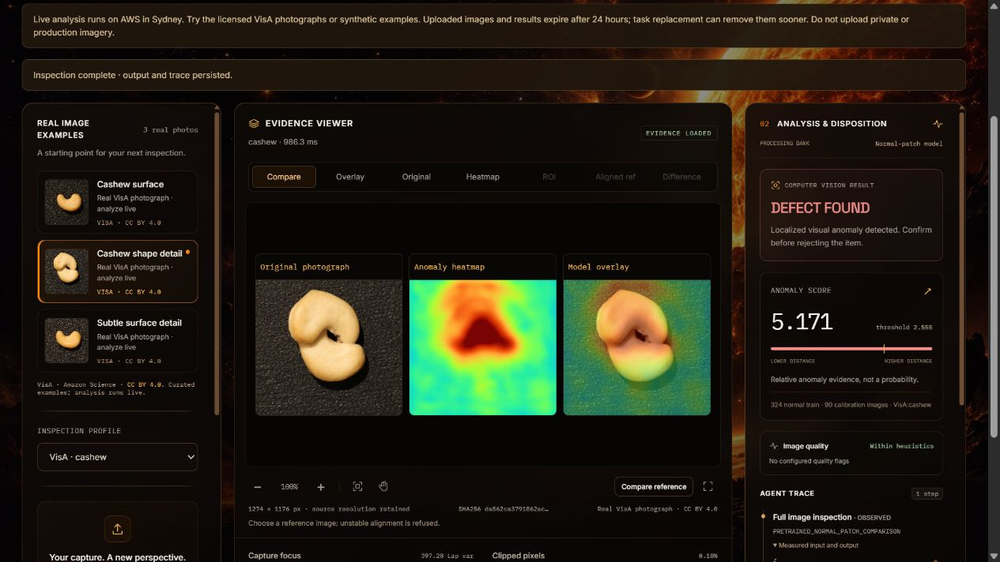

# Reviewer guide

[README](../README.md) · [Setup](GETTING_STARTED.md) · [Current status](PROJECT_STATUS.md) · [Evidence index](README.md)

## The quickest demonstration

Watch the [team's recorded demo](https://youtu.be/WvnKxOTxkvw), or open the [live AWS Inspection Studio](https://re-c0a0c131729f4898bb80d160feb0ccc7.ecs.ap-southeast-2.on.aws/). The video is also embedded in the [submitted OpenCV project](https://devpost.com/software/reflex-xqn8i7).

The public service is **v1**. Its real candle/cashew profiles compute a normal-patch comparison and preserve visual evidence. The local v2 crop policy and local Safety Station are separate capabilities, not additional deployed tabs.

## A one-minute tour

1. **0–10 seconds:** wait for **Vision service · AWS** and **OpenCV 5.0.0**. Keep **VisA · candle** selected.
2. **10–25 seconds:** select **Four-candle layout**. The recorded v1 result is **PASS**, score **1.547**, threshold **2.815**. Read the actual current values on screen.
3. **25–45 seconds:** select **Candle edge detail**. Its recorded v1 result is **DEFECT FOUND**, score **4.449**, threshold **2.815**. Compare the visible rim damage with the heatmap and overlay.
4. **45–60 seconds:** expand the **Agent Trace** measurement, then find **Evidence JSON** and **Print report**. Review records append a human decision without rewriting the model finding.

These recorded examples are interface demonstrations, not a two-image accuracy study. The [demo catalog](../demo/real/cases.json) preserves full source SHA-256 hashes for **Four-candle layout** (`visa-candle-1`) and **Candle edge detail** (`visa-candle-2`).

Recorded values were checked against retained v1 release evidence and the 26 October browser run; detailed private smoke receipts are not bundled as public runtime data. Scores are rounded for narration and are not probabilities.

## What each control means

| Control | What to inspect |
| --- | --- |
| Inspect | The capture library, profile selection and inspection workspace |
| History | Earlier records available in this service's temporary storage |
| Reports | JSON evidence or an HTML report for browser printing |
| Settings | Runtime, active profile, accepted images, storage and motion preference |
| Compare | Original photograph, anomaly heatmap and model overlay together |
| Original / Heatmap / Overlay | Each layer on its own; heat color represents anomaly distance |
| ROI | Crop evidence when the active profile actually produced it |
| Aligned ref / Difference | Outputs from the optional two-image alignment tool; not part of automatic anomaly inference |

Inactive controls do not imply hidden results. Real v1 profiles do not execute the local v2 calibrated detail pass. Reference comparison needs an actual second image; unstable alignment is refused.

## Include a failure, not just the attractive example

Select **Small rim detail** in candle, or **Subtle surface detail** in cashew. The curated catalog deliberately includes defective examples that v1 misses. A low score does not prove the item is defect-free. The [full study](../benchmarks/anomaly_v2/README.md) supplies the actual denominators and failures.

For a second product, choose **VisA · cashew → Cashew shape detail**. The 26 October browser run returned score **5.171**, threshold **2.555**, and **DEFECT FOUND**. Its profile has a different calibrated threshold; scores from different product profiles are not a shared confidence scale.

*Actual AWS screen, 26 October 2026. VisA / Amazon Science, CC BY 4.0; derived heatmap and overlay. [Media provenance](media/README.md).*

## Review the generated procedure evidence

The [procedure findings](../benchmarks/procedural_safety/public/FINDINGS.md), [54 saved policy rows](../benchmarks/procedural_safety/public/results.csv) and [all-case HTML gallery](../benchmarks/procedural_safety/public/index.html) describe **18 generated test clips**, each reused across three policies. GitHub shows the HTML as source; download the public tree and open that gallery file locally to view its relative evidence images.

To try the separate local Safety Station, follow [setup](GETTING_STARTED.md#generated-samples-without-model-weights) and open the launcher's printed `/safety` address. Choose a generated fixture, confirm authorized use, align the board calibration and process its replay. Keep the **SYNTHETIC SOFTWARE TEST** label visible. Recorded policies tie at 15/18 statuses; this is not a physical assembly demonstration or a proven agent accuracy gain.

## Public-demo boundary

Use only licensed, non-private imagery. The AWS service has no user login or tenant isolation, uses a per-process upload guard, and retains records for 24 hours unless its task is replaced sooner. Exports are temporary evidence, not archival storage. If the endpoint is unavailable, use the recorded video or local setup; no automatic cloud/local failover is claimed.
