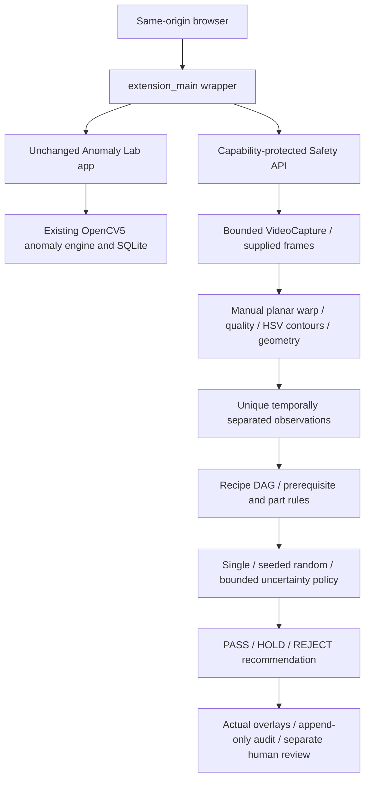

# Additive architecture

## Observation and procedure state

Manual calibration maps a planar panel into the recipe canvas. It does not establish automatic homography inlier accuracy or physical metrology. Tracking IDs identify a slot/class combination; they are not general multi-object identity tracks.

Occlusion and history gaps prevent unsupported sequence certainty. A currently visible wrong part may support an advisory rejection; missing history alone does not prove an order violation. State confirmation requires three unique, temporally separated observations. Duplicate pixel hashes provide no additional independent support.

## Timing and processing limits

Replay timestamps use OpenCV `POS_MSEC` with a declared-FPS fallback and an explicit timestamp-basis record. Variable-frame-rate accuracy is unvalidated. Offline processing time is separate from video event time and does not measure camera-to-alert display latency.

Base analysis samples every 300 ms and permits at most two extra replay frames. Limits are 600 decoded frames, a 120-second input, a 90-second processing loop and two active jobs. The live-frame API accepts at most 200 submissions over a 120-second source window.

The local server binds to `127.0.0.1` using an OS-assigned port. It holds the selected socket through startup and does not stop existing processes.

## Session access and audit

Session capabilities authorize media, evidence and review access. The server stores only the token hash. The UI uses tab-scoped storage and header-only authentication. Original model results and human acknowledgements remain separate, and completed runs cannot replace their input.

Reinspection requests create child sessions that wait for actual input. They do not fabricate an image or a new camera view. A child still image cannot establish an entire temporal procedure.

The original anomaly frontend script and styles, and all 143 frozen experiment files, remain unchanged. The original index receives only an additive navigation link.
